# ATSW — manual para el alumno

**Un caso de principio a fin: ¿cuánto pasa del precio del petróleo al IPC?**

Este manual te lleva de la mano por un análisis completo con ATSW. Partes de un
fichero con dos series mensuales y llegas a un modelo de función de
transferencia estimado, diagnosticado y usado para prever. Por el camino verás
**qué decide el programa, qué decides tú y con qué criterio**.

Todas las pantallas que aparecen aquí son del programa de verdad, haciendo
exactamente lo que dice el texto. Si sigues los pasos con el mismo fichero de
datos, tienes que ver lo mismo.

---

## Índice

1. [Antes de empezar](#1-antes-de-empezar)
2. [El caso](#2-el-caso)
3. [Un proyecto nuevo y los datos](#3-un-proyecto-nuevo-y-los-datos)
4. [La muestra](#4-la-muestra)
5. [Mirar la serie antes de decidir](#5-mirar-la-serie-antes-de-decidir)
6. [Identificar el modelo del IPC](#6-identificar-el-modelo-del-ipc)
7. [Estimar](#7-estimar)
8. [La diagnosis](#8-la-diagnosis)
9. [El petróleo: anómalos e intervenciones](#9-el-petróleo-anómalos-e-intervenciones)
10. [Declarar el modelo elegido](#10-declarar-el-modelo-elegido)
11. [El caso: las dos series juntas](#11-el-caso-las-dos-series-juntas)
12. [La función de transferencia en drtran](#12-la-función-de-transferencia-en-drtran)
13. [La previsión](#13-la-previsión)
14. [Lo que queda por hacer](#14-lo-que-queda-por-hacer)
15. [Las reglas de oro](#15-las-reglas-de-oro)
16. [Glosario](#16-glosario)

---

## 1. Antes de empezar

### Instalar

- **Windows**: ejecuta `ATSW-…-windows-x64-setup.exe`. No pide permisos de
  administrador. La primera vez Windows avisa de que no conoce el programa:
  pulsa «Más información» y «Ejecutar de todas formas». Queda en el menú
  Inicio como **ATSW**.
- **macOS** (14 o posterior): abre el `.dmg` y arrastra ATSW a Aplicaciones. La
  primera vez macOS no la deja abrir; ve a *Ajustes del Sistema → Privacidad y
  seguridad* y pulsa «Abrir igualmente».

El `LEEME.txt` que acompaña al instalador lo explica con más detalle.

### Las piezas

ATSW no es un programa sino un **taller**: una ventana principal desde la que
se abren las herramientas de cada escalón.

| Programa | Para qué |
|---|---|
| **ATSW — el taller** (`atsw_gui`) | La ventana principal: proyectos, series, muestras, modelos y casos. Todo empieza aquí. |
| **fue_gui** | Editor y estimador de modelos univariantes (en inglés). |
| **drtran_gui** | Funciones de transferencia y redes de transferencias. |
| **gtk_fmg** | Gráficos. |

Debajo trabajan los **motores** de cálculo: `art` identifica, `fue` estima
modelos univariantes por máxima verosimilitud exacta, `fuf` prevé, `fug`
dibuja y `drtran` estima transferencias. No hace falta
llamarlos a mano: las ventanas lo hacen por ti. Las ventanas que abre el
taller se cierran con él; si queda alguna abierta al salir, pregunta antes.

### La escalera

El método sube por escalones, y **cada escalón parte del anterior**:

1. **Univariante**: cada serie, por separado, con su propio modelo ARIMA.
2. **Transferencia**: una serie (la *salida*) responde a otras (las
   *entradas*). Se parte de los modelos univariantes del paso 1.
3. **VARMA**: varias series que se afectan entre sí (drvarma; todavía no
   viene en el paquete).

En este manual subes los dos primeros escalones.

### Tres clases de fichero

Te los vas a encontrar continuamente:

| Fichero | Qué es |
|---|---|
| `.inp` | Una **especificación**: qué modelo quieres estimar. Sus números son *semillas*, un punto de partida. |
| `.out` | El **registro** de una estimación: parámetros, errores típicos, verosimilitud y la diagnosis. |
| `.pre` | El mismo `.inp` con las estimaciones dentro: un **óptimo**. Si lo vuelves a estimar, los números no se mueven. |

Dos reglas que conviene aprender pronto:

- **Un `.pre` no se escribe a mano.** Solo el programa que estimó puede afirmar
  que unos números son el óptimo.
- **Un `.pre` que se toca vuelve a ser un `.inp`**: si cambias algo, ya es otro
  modelo, y hay que estimarlo.

### El método en una frase

> Decidir, estimar, mirar los residuos, revisar.

Es un **bucle**. Volver atrás no es un fracaso: es el método funcionando. Y en
cada vuelta **el juicio va primero y los contrastes formales después**: lo que
se decide antes de estimar se apoya en el gráfico, el correlograma y lo que
sabes de la serie. Un contraste sobre un modelo que todavía no es adecuado no es
un contraste débil: no es un contraste.

**El programa te enseña la evidencia, pero decides tú.** Verás muchas veces la
palabra *propuesto*: es una propuesta, no un veredicto.

---

## 2. El caso

Dos series mensuales, de enero de 2002 a diciembre de 2025:

- **ipc**: el índice de precios de consumo de España.
- **wti**: el precio del barril de petróleo West Texas Intermediate, en dólares.

**La pregunta**: cuando sube el petróleo, ¿cuánto sube el IPC y con qué
retardo? En economía se le llama *pass-through*, la transmisión del precio del
crudo a los precios de consumo.

El fichero está en [`datos/ipc_wti.csv`](datos/ipc_wti.csv): una columna de
fechas y una por serie.

---

## 3. Un proyecto nuevo y los datos

Abre **ATSW**. Primero sale la **presentación**, con la versión y los
créditos:

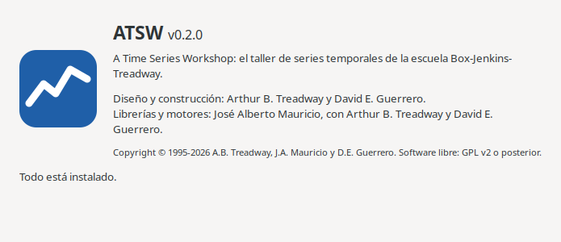

Mientras se ve, ATSW comprueba que la instalación está completa: los motores,
las ventanas y lo que necesitan para dibujar. Si no falta nada (*Todo está
instalado*), se cierra sola y abre el taller. Si falta algo, se queda abierta
y dice qué falta y cómo arreglarlo; **Copiar el informe** lo copia para
mandarlo por correo. La misma comprobación está en **Ayuda ▸ Comprobar la
instalación…**.

La ventana principal está vacía:

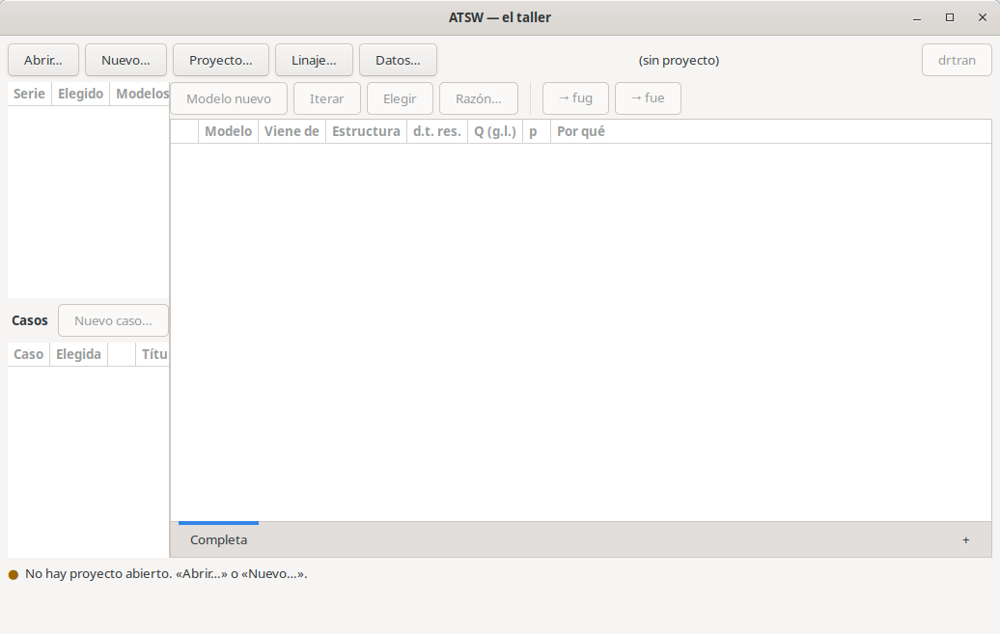

Arriba está la **barra de menús**, ordenada como el trabajo:

| Menú | Qué tiene |
|---|---|
| **Proyecto** | Nuevo, abrir, releer, las propiedades, el linaje, el cuaderno y salir. |
| **Datos** | Importar series, editar una serie, declarar una muestra y los gráficos de mirar los datos. |
| **US** | Los modelos **univariantes**, en el orden del ciclo: identificar, estimar, diagnosticar, prever y elegir. |
| **MT** | Los modelos de **transferencia**: los casos y sus modelos. |
| **Ayuda** | Este manual (F1), las teclas, la comprobación de la instalación y los créditos. |

Los botones de la fila de arriba hacen lo más frecuente, y el **botón
derecho** sobre una fila saca el menú de lo que se puede hacer con ella: las
mismas entradas que la barra. Al pasar por una entrada, la barra de estado de
abajo dice qué hace o, si está apagada, por qué.

**Un proyecto es una carpeta** con un fichero `proyecto.yaml` que lo recuerda
todo: qué series hay, qué modelos has estimado, de cuál viene cada uno y **por
qué** lo hiciste. No hay botón de guardar: cada cambio se escribe solo.

1. Pulsa **Nuevo…** (o *Proyecto ▸ Nuevo…*, Ctrl+N), crea una carpeta para el proyecto (por ejemplo
   `ipc-wti`) y acepta el nombre `proyecto.yaml`. Pulsa **Crear**.
2. Pulsa **Datos…** (*Datos ▸ Importar series…*) y elige `ipc_wti.csv`. ATSW lee el fichero y te enseña lo
   que ha encontrado:

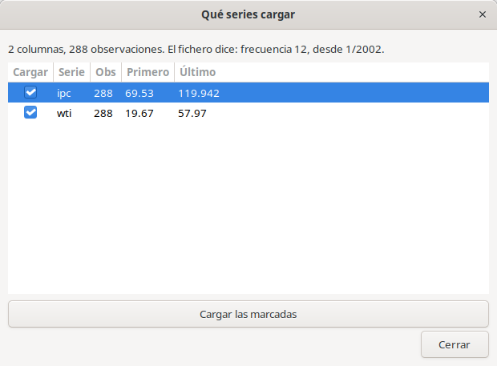

Fíjate en la primera línea: *frecuencia 12, desde 1/2002*. ATSW lo ha deducido
de las fechas. Si tu fichero no tuviera fechas, te avisaría de que lo carga como
anual desde el año 1, y eso no es lo que quieres.

3. Deja marcadas las dos series y pulsa **Cargar las marcadas**. Después,
   **Cerrar**.

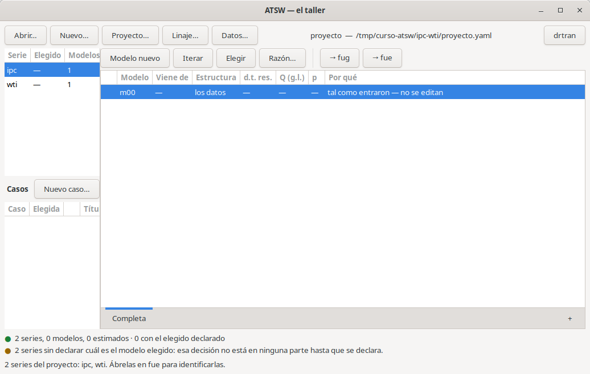

A la izquierda están las series (**Series — US**) y, debajo, los casos; a la
derecha, los modelos de la serie marcada. El separador entre los dos lados se
puede mover.
De momento cada una tiene solo **m00**, que son los datos tal como entraron:
m00 no se edita nunca.

---

## 4. La muestra

Los datos llegan a 2025, pero **no queremos que el modelo tenga que explicar
2020**: la pandemia fue un suceso único que, metido en la estimación, deformaría
la relación normal entre petróleo e inflación. Estimaremos con los datos
anteriores a la pandemia.

Para eso se **declara una muestra**. Pulsa el **+** que hay junto a la pestaña
«Completa», abajo a la derecha (o *Datos ▸ Muestra nueva…*):

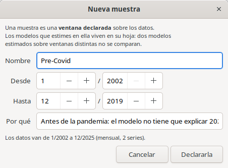

- **Nombre**: `Pre-Covid`. Es lo que aparecerá en la pestaña.
- **Desde** 1/2002, **Hasta** 12/2019.
- **Por qué**: escríbelo. Dentro de un mes, una ventana sin razón es un número
  que nadie sabe de dónde salió.

Pulsa **Declararla**. Aparece una pestaña nueva, **Pre-Covid**:

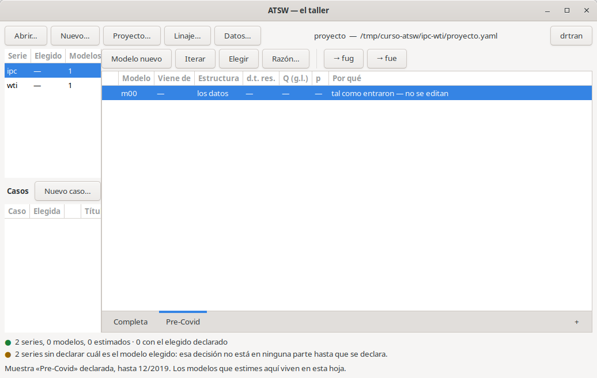

**Cada muestra es una hoja aparte.** Los modelos que estimes en Pre-Covid viven
en su hoja: dos modelos estimados sobre ventanas distintas no se comparan.
A partir de aquí trabajamos siempre en la pestaña **Pre-Covid**.

---

## 5. Mirar la serie antes de decidir

Marca **ipc** y pulsa el botón derecho del ratón. Este es el menú de una
serie, en el orden del ciclo: mirar e identificar, empezar un modelo, y lo que
es de la serie como dato:

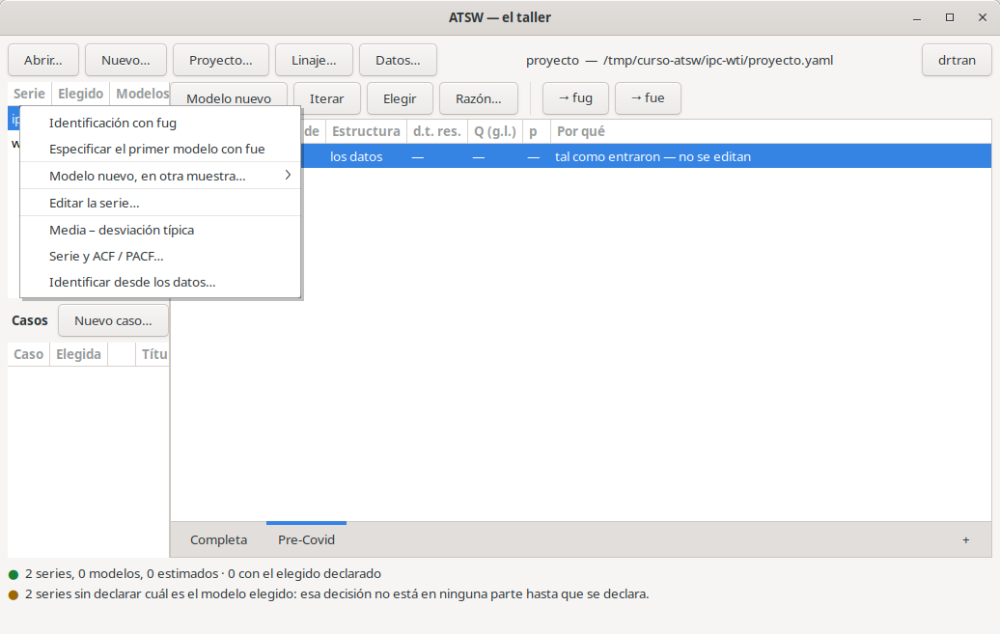

Antes de identificar nada, **mira la serie**.

### El dominio: qué clase de serie es

La primera decisión no la toma ningún contraste. Es tuya, y va **antes** de
mirar qué modelo ajusta mejor: **¿qué clase de serie es?**

El IPC es un **índice de precios**. Eso ya dice mucho:

- Un índice no tiene un cero natural, y lo que importa de él son las
  variaciones *relativas* (la inflación es un porcentaje). Por eso **un índice
  de precios va siempre en logaritmos** (λ = 0).
- La teoría espera **inercia**: la inflación de este mes se parece a la del mes
  pasado.

Escribe esto antes de seguir. Una explicación elegida *después* de ver qué
modelo ajusta no es un criterio.

### La transformación: el gráfico media – desviación típica

**Media – desviación típica** (también en el menú **Datos**) dibuja, para cada año, la media frente a la
desviación típica:

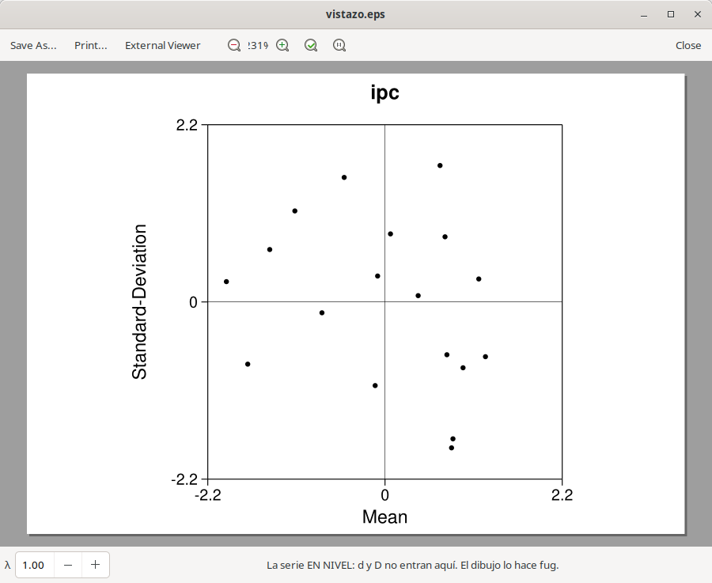

Si la nube sube hacia la derecha (los años de nivel alto varían más), la serie
pide logaritmos. Si es horizontal, niveles. Aquí la nube no es concluyente, y
**cuando el gráfico no decide, manda el dominio**: logaritmos.

### Serie y correlogramas

**Serie y ACF / PACF…** enseña la serie con su función de autocorrelación
(ACF) y su autocorrelación parcial (PACF):

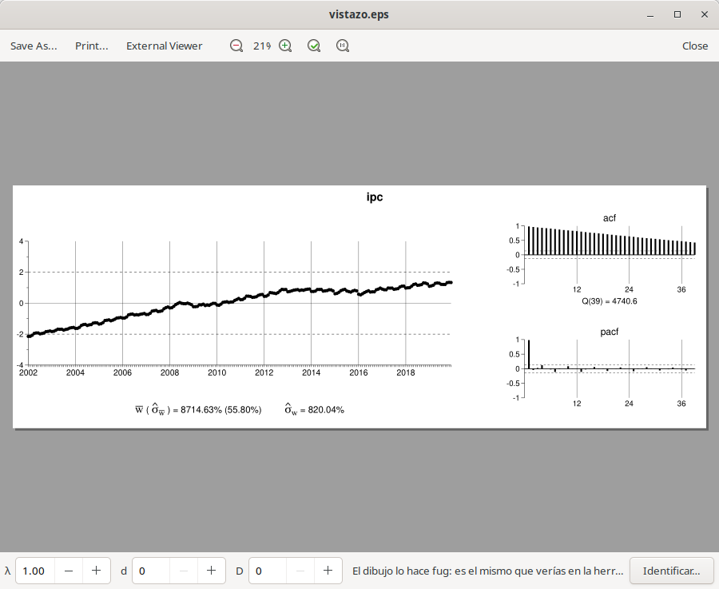

Una ACF que **decae muy despacio** es la marca de una serie que no es
estacionaria: hay que diferenciarla.

Al pie, λ, d y D vuelven a dibujarla transformada y diferenciada, y
**Identificar la estructura ARIMA…** lleva al paso siguiente. Arriba, en las
dos ventanas, **Al cuaderno** apunta el gráfico en el
[cuaderno del proyecto](#el-cuaderno-del-proyecto). En el menú **Datos** está
además el **Histograma…** de la serie transformada y diferenciada.

---

## 6. Identificar el modelo del IPC

En el menú de la serie, elige **Identificar la estructura ARIMA…**. Se abre la
ventana de identificación, que llama a **art**:

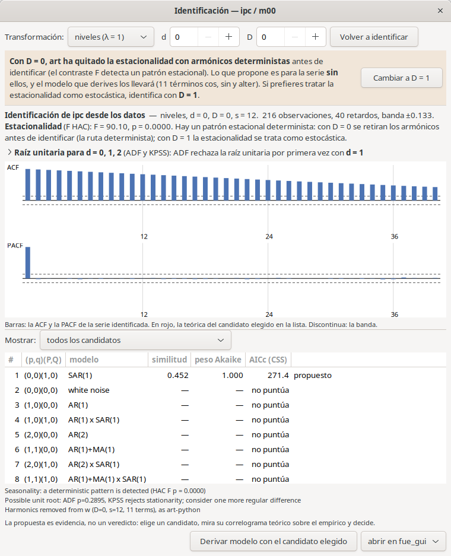

art ha empezado por lo más simple: niveles (λ = 1) y sin diferencias (d = 0).
Lee de arriba abajo:

- **El recuadro de color** avisa de que hay **estacionalidad** y de que art la
  ha quitado con **armónicos deterministas** (ondas de seno y coseno de periodo
  12, 6, 4…) antes de identificar. Volveremos a esto enseguida.
- **Raíz unitaria para d = 0, 1, 2**: pulsa la línea y se despliega una tabla
  con los contrastes **ADF** (H₀: raíz unitaria) y **KPSS** (H₀: estacionaria)
  para las tres d a la vez. Con d = 0, ADF no rechaza la raíz unitaria y KPSS
  rechaza la estacionariedad: los dos dicen lo mismo, **mira d = 1**. La línea
  plegada ya lo resume: ADF rechaza por primera vez con d = 1. Es una ayuda
  para elegir d, no un contraste formal.
- **La ACF** decae despacísimo. El gráfico dice lo mismo que los contrastes.

### Las tres decisiones de arriba

Cambia la fila de arriba a lo que has decidido:

1. **Transformación: logaritmos (λ = 0)**, porque es un índice.
2. **d = 1**, porque la ACF y los contrastes lo piden.
3. **D = 0**: la estacionalidad, determinista (ahora explicamos por qué).

Pulsa **Volver a identificar**:

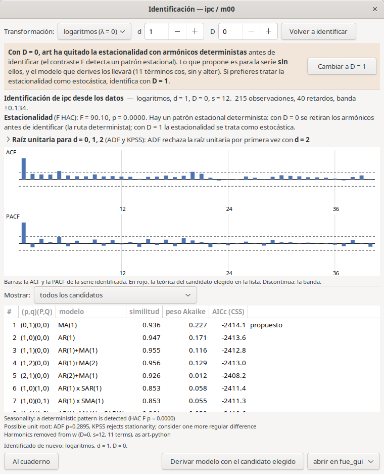

**d se sube de uno en uno**, nunca de 0 a 2: diferenciar de más no es un error
venial, mete una raíz en el modelo que luego no se puede quitar. En logaritmos y
con d = 1 los contrastes ya no coinciden: ADF *casi* rechaza (p = 0.052) y KPSS
no. Por eso la línea plegada dice ahora que ADF rechaza por primera vez con
d = 2. Pero la tabla avisa de que la serie es estacional, y ADF, que no modela
la estacionalidad, tiende entonces a pedir una diferencia de más: **decide el
correlograma**, que ya no decae despacio. La tabla da el punto de partida, no
la respuesta.

### ¿Estacionalidad determinista o estocástica?

Hay dos maneras de tratar la estacionalidad:

- **Determinista** (D = 0, con armónicos): el patrón del año se repite igual,
  como un calendario fijo.
- **Estocástica** (D = 1, diferencia estacional): el patrón cambia poco a poco
  de un año a otro.

La regla de la escuela es **empezar por la determinista como hipótesis de
trabajo**, por dos razones:

1. Desde la determinista se puede pasar a la estocástica frecuencia a
   frecuencia si los contrastes lo piden al final; al revés no se puede.
2. Una diferencia estacional que sobra mete una raíz falsa *antes* de
   identificar el resto del modelo.

Además, **este modelo va a ir a una función de transferencia**, y para los
modelos multivariantes la especificación de elección es la determinista. Así
que D = 0. El botón **Cambiar a D = 1** está ahí para cuando la quieras
estocástica; aquí no lo usamos.

### Elegir el candidato

Abajo está la lista de candidatos que propone art:

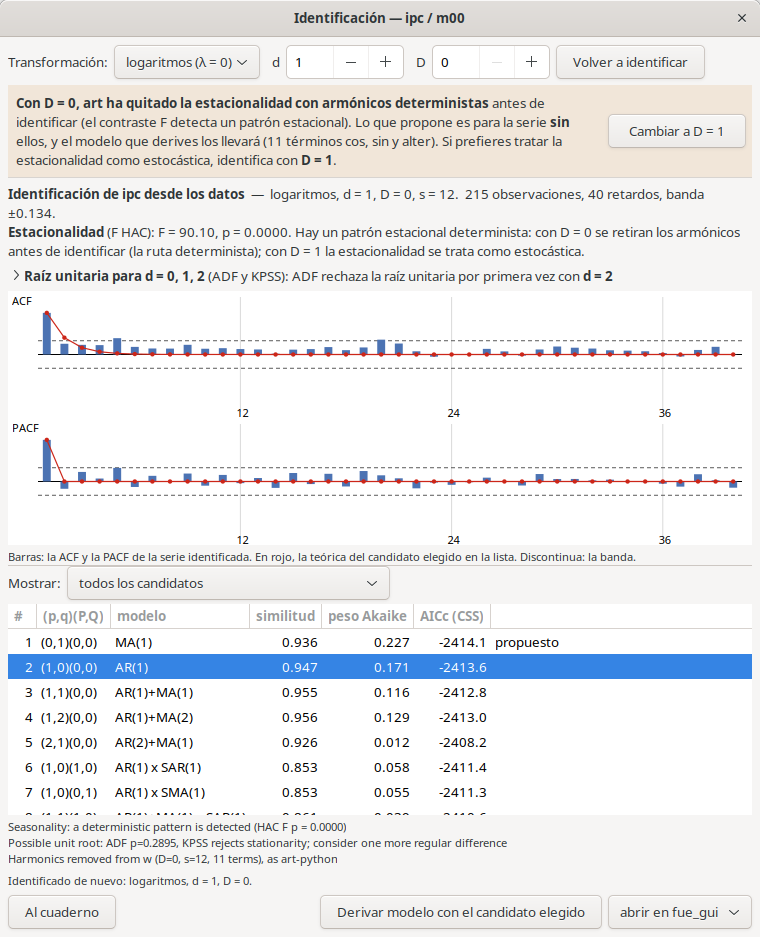

| Columna | Qué dice |
|---|---|
| **(p,q)(P,Q)** | Los órdenes AR y MA, regulares y estacionales. |
| **similitud** | Cuánto se parece la ACF/PACF teórica del candidato a la de los datos. |
| **peso Akaike** | La probabilidad relativa del candidato según el AIC. |

art **propone MA(1)** (el de más peso Akaike), pero **AR(1)** tiene más
similitud (0.947 frente a 0.936). Los dos están muy cerca: es un **empate**.

Al marcar un candidato, su ACF y PACF teóricas se dibujan en rojo sobre las de
los datos. Con AR(1) la PACF corta después del primer retardo y la ACF decae:
la firma de un AR(1).

**Cómo se rompe el empate**: con el dominio. Para un índice de precios en
logaritmos con d = 1, la inercia de la inflación pide un **AR(1)**. Un MA(1)
diría que un choque de inflación desaparece al mes siguiente, y además daría
pesos de previsión que cambian de signo. Elegimos **AR(1)**.

> **La propuesta es evidencia, no un veredicto.** El programa lo dice al pie de
> la ventana. Mira el correlograma teórico sobre el empírico y decide.

Si dudas de verdad entre dos candidatos, **estima los dos**: los empates se
resuelven estimando, no eligiendo.

Marca **AR(1)**, elige **abrir en el editor** en el desplegable de abajo a la
derecha y pulsa **Derivar modelo con el candidato elegido**. Nace el modelo
**m01**, con la razón ya escrita (de qué candidato viene y por qué).

> El menú de la serie tiene también **Listado de identificación…**: la
> primera identificación completa de fug, en texto, como la daba el programa
> clásico.

---

## 7. Estimar

Se abre el editor con el `.inp` de m01:

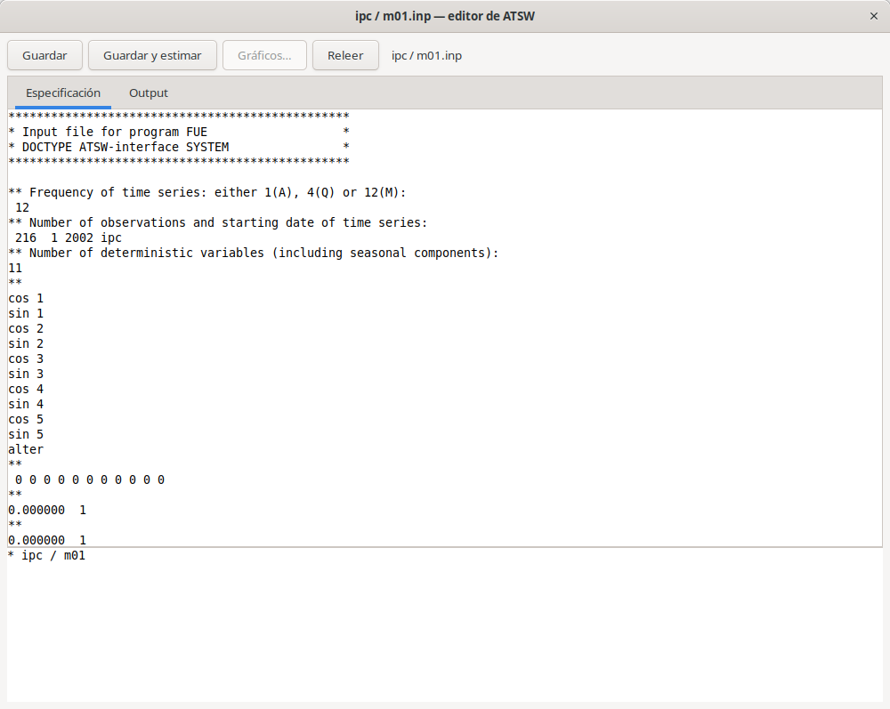

Es el **modelo especificado**: logaritmos, d = 1, un AR(1), los armónicos
deterministas y la media μ. Los valores son semillas.

> **¿Por qué lleva media?** Con una diferencia (d + D = 1), μ es la **deriva**:
> el crecimiento medio de la serie. ATSW la deja libre sólo si la serie
> transformada y diferenciada tiene una media significativa (\|t\| ≥ 2). El
> IPC sube de media cada mes (t = 3.1), así que m01 lleva μ; el petróleo no
> tiene deriva (t = 0.6), y su modelo no la lleva. Sin diferencias, μ es el
> nivel y va siempre; con dos, no va nunca.

Pulsa **Guardar y estimar**: el motor **fue** lo estima por máxima
verosimilitud exacta. En la pestaña **Output** está la salida:

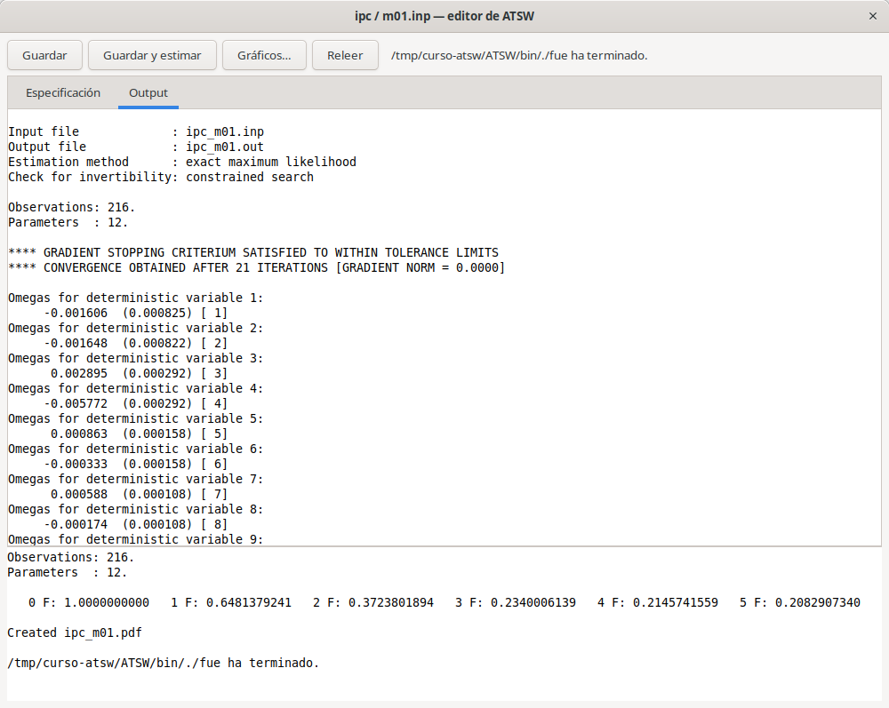

Lo primero que hay que leer es que **convergió**
(*CONVERGENCE OBTAINED*). Luego vienen los parámetros con su error típico
entre paréntesis.

Cierra el editor. En la ventana principal, m01 ya tiene sus números:

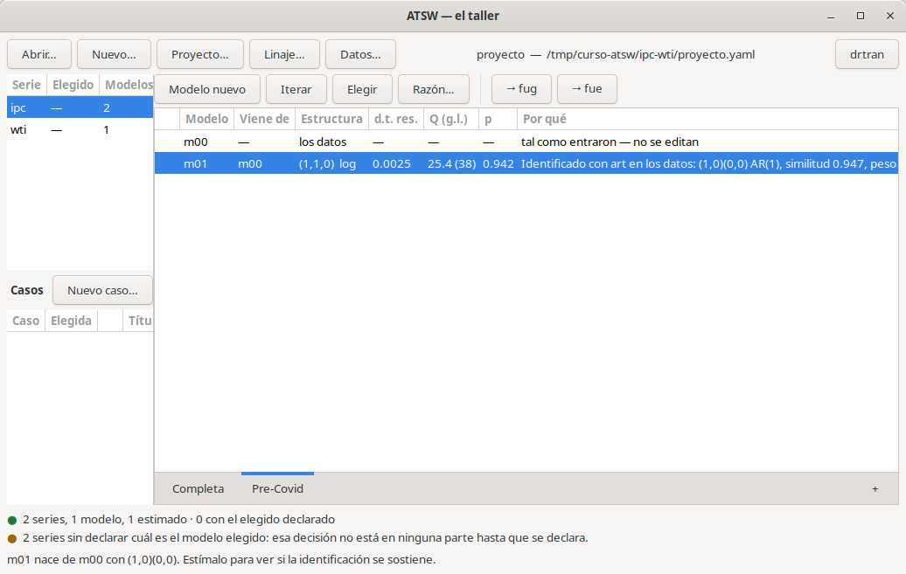

| Columna | Qué dice |
|---|---|
| **Viene de** | El modelo del que nace: m01 viene de m00, los datos. |
| **Estructura** | (p,d,q) y la transformación. |
| **d.t. res.** | La desviación típica de los residuos. |
| **Q (g.l.)**, **p** | El contraste de Ljung-Box sobre los residuos y su valor p. |
| **Por qué** | La razón del modelo. |

> Si prefieres trabajar en **fue_gui** (el estimador clásico), el botón
> **Estimar** de la fila de modelos, o **Estimar m01** en el botón derecho
> (Ctrl+E), abre el modelo marcado en fue. Hace lo mismo con más detalle:
> una pestaña por cada parte del modelo. Su barra sigue el ciclo de trabajo:
> **Nuevo**, **Abrir**, **Guardar**, **Estimar** y **Ver modelo**. Después vienen
> tres botones con menú: **Diagnosis** (la diagnosis, los anómalos, la
> ganancia, identificar los residuos, la factorización del AR y exportar),
> **Contrastes** (el orden de integración y la estacionalidad) y **Prever**. Un
> clic en el botón hace lo habitual; la flecha de al lado abre el resto.
>
> 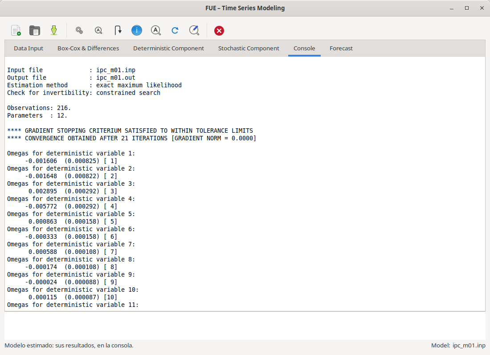

---

## 8. La diagnosis

Botón derecho sobre m01. Este es el menú de un modelo:

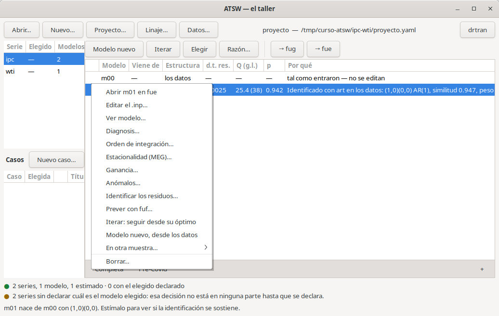

Arriba, estimar y derivar otros modelos de este. Lo que se le pregunta a un
modelo estimado va en el submenú **Diagnosticar ▸**: la diagnosis, el orden
de integración, la estacionalidad, la ganancia y la factorización del AR.
Justo debajo, a mano, lo que se mira al volver de estimar: **Ver modelo…**,
**Anómalos…** e **Identificar los residuos…**. Después, prever, y al final
las decisiones: elegir, la razón y borrar. Son las mismas entradas que el menú
**US** de la barra.

Elige **Diagnosticar ▸ Diagnosis…**:

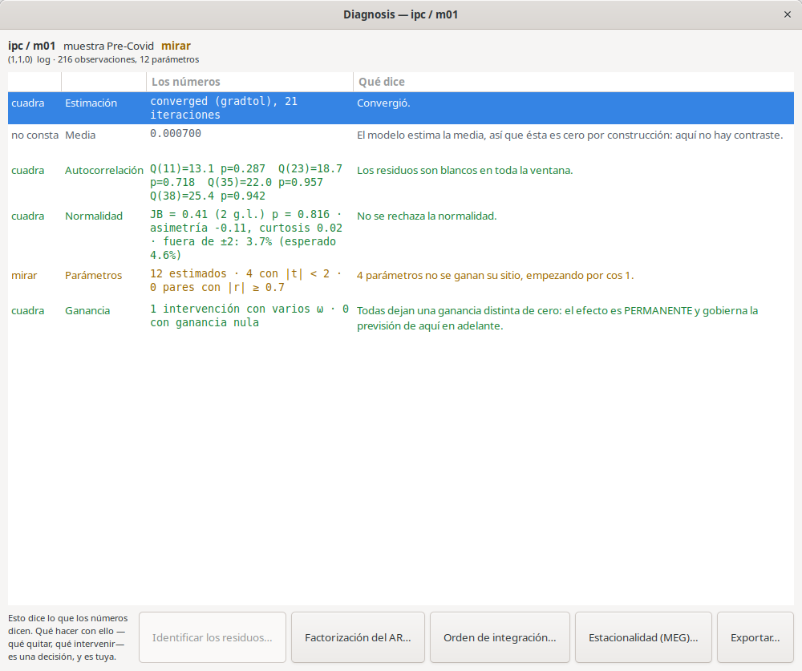

Cada fila es una pregunta, con **los números** y **qué dicen**:

| Fila | La pregunta | Aquí |
|---|---|---|
| **Estimación** | ¿Convergió? | Sí. |
| **Media** | ¿Los residuos tienen media cero? | m01 estima la media (μ, la deriva del IPC), así que es cero por construcción y no hay contraste. En un modelo sin μ, como los de wti, la fila contrasta de verdad que la media de los residuos sea cero. |
| **Autocorrelación** | ¿Los residuos son ruido blanco? | Sí: ninguna Q de Ljung-Box rechaza. |
| **Normalidad** | ¿Son normales? | Sí (Jarque-Bera, p = 0.68). |
| **Parámetros** | ¿Son significativos? | De los 13, **3 no lo parecen** (\|t\| < 2), empezando por un armónico (sin 4). |
| **Ganancia** | ¿El efecto de una intervención es permanente? | No aplica: m01 no tiene intervenciones. |

**Factorización del AR…** (un botón de la diagnosis, y también en
**Diagnosticar ▸**) parte cada factor autorregresivo en sus factores: primero
el polinomio y la tabla de sus raíces; después los factores reales (1 − a B) y
los pares complejos (1 − a₁ B − a₂ B²), cada grupo en su tabla y el más
cercano a la unidad primero. De cada par da su amortiguamiento, su frecuencia y
su periodo. Un par con el periodo en una frecuencia estacional (12, 6, 4…
meses) y el amortiguamiento cerca de 1 sería un AR estacional escondido dentro
del AR.

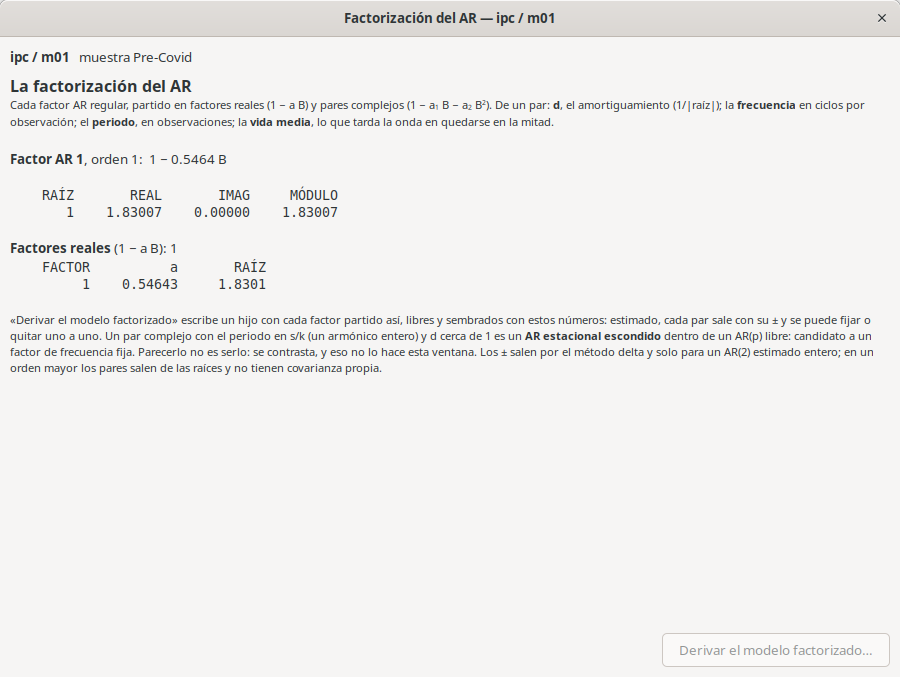

En m01, un AR(1) con φ̂ = 0.40, sale una sola raíz real, 2.48: no hay nada
escondido. Es una herramienta de identificación, no un contraste: si un par
lo parece, se contrasta aparte. Para eso está **Derivar el modelo factorizado…**: escribe un
hijo con cada factor AR partido así, libre y sembrado con estos números, para
estimarlo y fijar o quitar un factor cada vez. En m01 está apagado, porque un
AR(1) ya no se puede partir más.

Los **contrastes formales** contrastan hipótesis sobre el modelo estimado, como
el `formal_tests` de art. Cada contraste es una estimación más: fue reestima el
modelo con un parámetro fijo en su valor nulo, partiendo del óptimo, y se
comparan las dos log-verosimilitudes. Se calculan uno detrás de otro sin
bloquear la ventana. Son de dos tipos y van en dos ventanas: **Orden de
integración…** (la diferencia regular) y **Estacionalidad (MEG)…**, que sólo se
enciende si la serie es estacional (s > 1). Se abren desde los dos botones de
la diagnosis, desde **Diagnosticar ▸** (en el botón derecho y en el menú
**US**) y desde la barra de fue_gui (el menú del botón **Contrastes**).

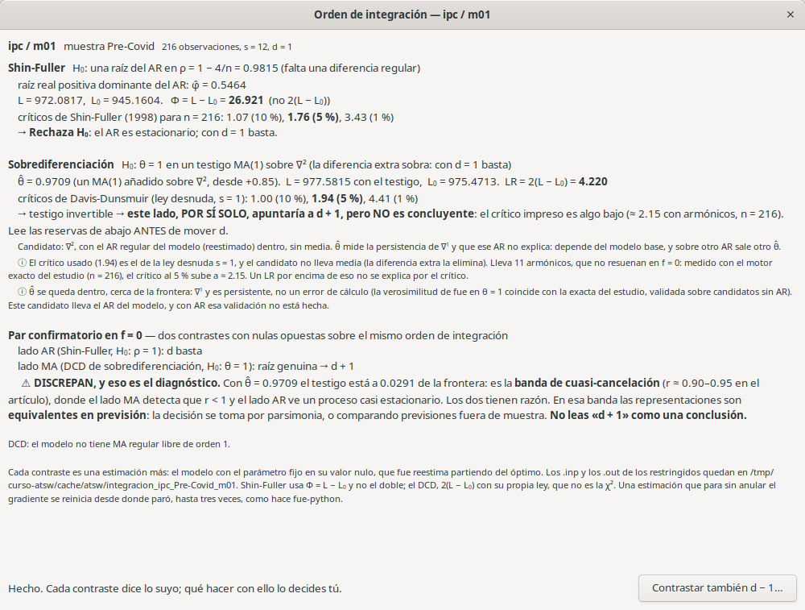

- **Shin-Fuller**: ¿le falta una diferencia al AR, es decir, tiene una raíz en
  1 − 4/n? Φ = 37.5 frente a un crítico de 1.76: no; con d = 1 basta.
- **Sobrediferenciación**: se impone una diferencia más (d = 2) con un testigo
  MA(1), y se pregunta si el testigo se apila en θ = 1, o sea, si la diferencia
  extra sobra. Aquí θ̂ = 0.971 y LR = 4.22 frente a 1.94: por sí solo apuntaría
  a d = 2, y la ventana avisa de que **no es concluyente**. El crítico 1.94 es
  el de la ley sin deterministas (con los 11 armónicos sería ≈ 2.15), pero 4.22
  queda por encima de los dos: lo que lo explica es el par, justo debajo.
- El **DCD** (¿sobra una diferencia regular?) mira un MA(1) en su frontera, y
  m01 no tiene MA: la ventana dice que no aplica.

Shin-Fuller y la sobrediferenciación forman el **par confirmatorio en f = 0**:
miran el mismo orden de integración con nulas opuestas. En m01 discrepan, y la
ventana lo explica: con θ̂ = 0.971 el testigo está a 0.03 de la frontera, en la
**banda de cuasi-cancelación**. Ahí las dos representaciones (d = 1 con un AR
casi unitario, o d = 2 con un MA casi unitario) son equivalentes en previsión,
y la decisión no la toman estos estadísticos sino la parsimonia: **d = 1**.

**Contrastar también d − 1…** pregunta lo contrario: ¿sobraba la última
diferencia? No se corre solo, porque correrlo siempre sería contrastar sin
motivo. Se pide cuando la serie parece estacionaria en nivel, es un precio
relativo o se está en un estudio de cointegración.

La ventana de la **estacionalidad** lleva el resto:

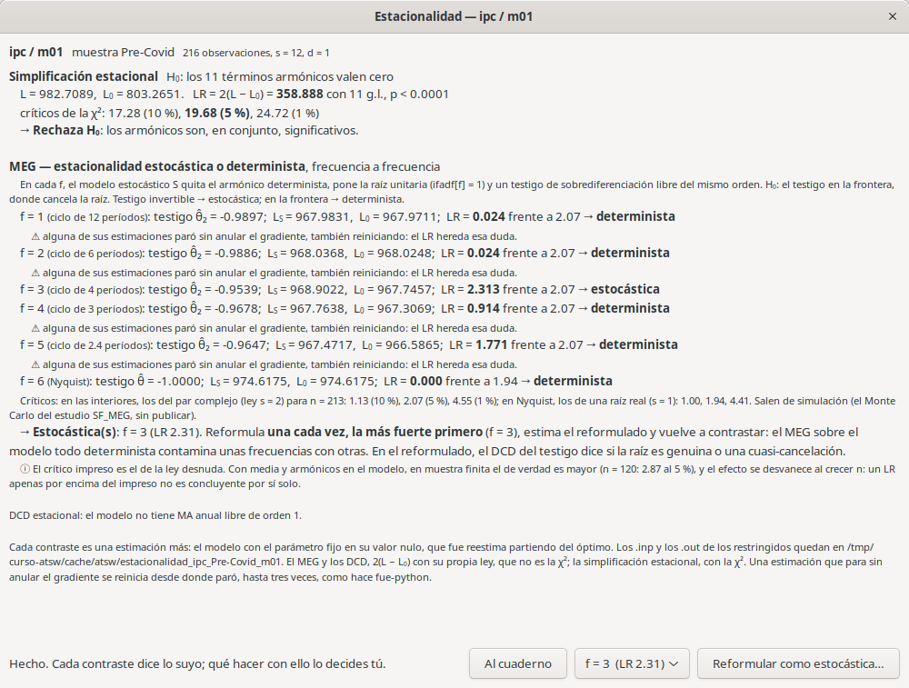

- **Simplificación estacional**: ¿sobran los 11 armónicos a la vez? LR = 359
  con 11 grados de libertad, muy por encima del crítico (19.7): no sobran.
- El **DCD estacional** (¿sobra la diferencia estacional?) mira un MA anual en
  su frontera; m01 no lo tiene, y la ventana dice que no aplica.

El **MEG** (los **modelos MEG**, de estacionalidad híbrida por frecuencias)
pregunta, frecuencia a frecuencia, si la estacionalidad es **estocástica o
determinista**. Se aplica a modelos como m01,
con D = 0 y armónicos. En cada frecuencia f construye el modelo estocástico:
quita el cos/sin de f (o el alter en f = 6), pone la raíz unitaria estacional de
esa frecuencia y un **testigo** MA libre. Luego mira si el testigo se apila en
la frontera, donde cancela la raíz: si se apila, la estacionalidad en f es
determinista; si queda invertible, es estocástica. En m01 sale estocástica
sólo f = 3 (LR = 2.31, frente a un crítico de 2.07), y las demás
deterministas; la que más se acerca es f = 5 (LR = 1.77). Es por poco: con
media y armónicos en el modelo, el crítico real en muestra finita es mayor, y
la ventana lo avisa. Los críticos salen de
simulación.

**Reformular como estocástica…** deriva el modelo estocástico de la frecuencia
elegida (de entrada, la más fuerte) como un hijo del modelo, para estimarlo y
volver a contrastar. Se reformula una frecuencia cada vez, porque el MEG sobre
el modelo todo determinista contamina unas frecuencias con otras; lo que digan
las demás se lee sobre el reformulado. En él, el DCD del testigo dice si la
raíz es genuina. En este curso seguimos con m01: el IPC va a entrar en un
modelo de transferencia con el petróleo, y para un modelo que entra en un
sistema la estacionalidad se trata como determinista (art hace lo mismo): si
las series no llevan el mismo tratamiento, sus órdenes de integración no son
comparables.

Cada contraste dice su número, sus críticos y lo que dice. Y suponen un modelo
**adecuado**: se pasan con la diagnosis limpia. Si no lo está, no se impide
abrirlas, pero las dos ventanas lo avisan arriba.

**Q de Ljung-Box**: se calcula en los retardos 12, 24, 36 y 39 (en general s,
2s, 3s y 3s + 3); entre paréntesis van sus grados de libertad, el retardo menos
los parámetros ARMA. El veredicto lo da el último, el más exigente. Si
una Q rechaza, no dice *qué* retardo falla: eso lo dicen las barras de la ACF
residual que se salen de la banda ±2/√n.

**Ver modelo…**, justo debajo de **Diagnosticar ▸**, enseña el resumen del
modelo estimado, sin abrir fue: los residuos con su ACF y PACF, el modelo
escrito debajo con la desviación típica de cada coeficiente (y σ̂, en las
unidades de la ecuación), y los residuos grandes. Sólo se enciende cuando el
modelo está estimado.

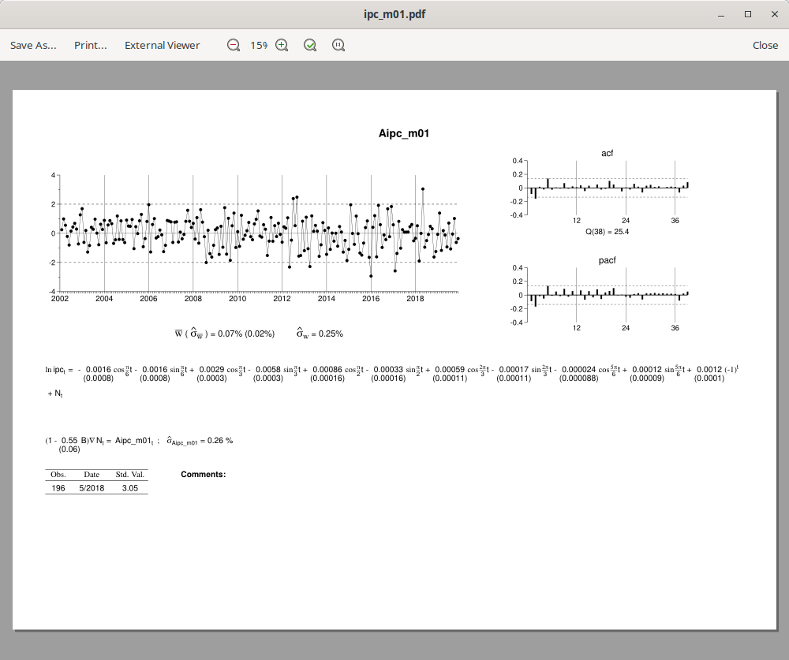

### Los parámetros que no parecen significativos

Tres armónicos tienen \|t\| < 2. La tentación es quitarlos. **No todavía**:

- Un armónico con t baja puede ser un indicio de que esa frecuencia estacional
  es **estocástica**, no determinista. El contraste que lo decide (el **MEG**)
  va **antes** de podar armónicos.
- Este modelo va a una transferencia, y ahí la estacionalidad se mantiene
  determinista.

Así que m01 se queda como está. **Un modelo adecuado** quiere decir: centrado,
con residuos ruido blanco y normales. m01 lo es.

> Fíjate en la línea de abajo de la ventana: *«Esto dice lo que los números
> dicen. Qué hacer con ello —qué quitar, qué intervenir— es una decisión, y es
> tuya.»*

### El cuaderno del proyecto

La diagnosis, los contrastes, la identificación, los anómalos, la ganancia y
las ventanas de gráficos tienen un botón **Al cuaderno**. Apunta lo que estás
mirando en el **cuaderno del proyecto**, un fichero Markdown
(`cuaderno/cuaderno.md`, junto a `proyecto.yaml`), con la fecha y de dónde
sale: la serie, el modelo, la muestra y el `.out`. Los gráficos van como
imagen. **Cuaderno…**, en la fila de arriba o en el menú **Proyecto**, lo
enseña en orden y deja añadir notas tuyas:

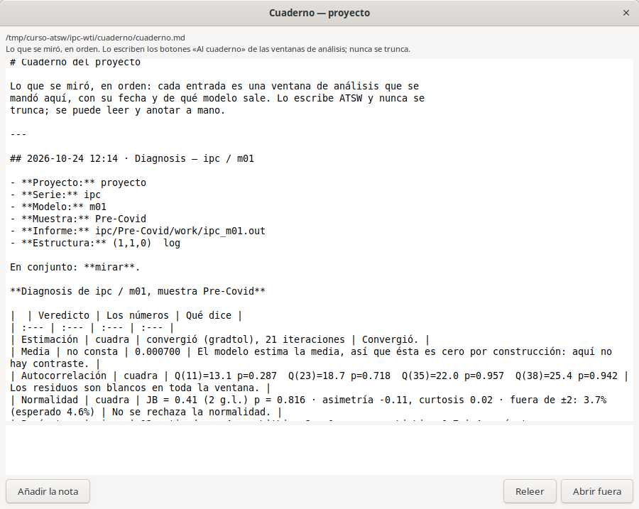

El cuaderno solo crece: nada de lo apuntado se borra. **Abrir fuera** lo abre
con el programa que tengas para Markdown, que pinta las tablas y los gráficos.

---

## 9. El petróleo: anómalos e intervenciones

Ahora **wti**, por el mismo camino: logaritmos (un precio), d = 1, D = 0.

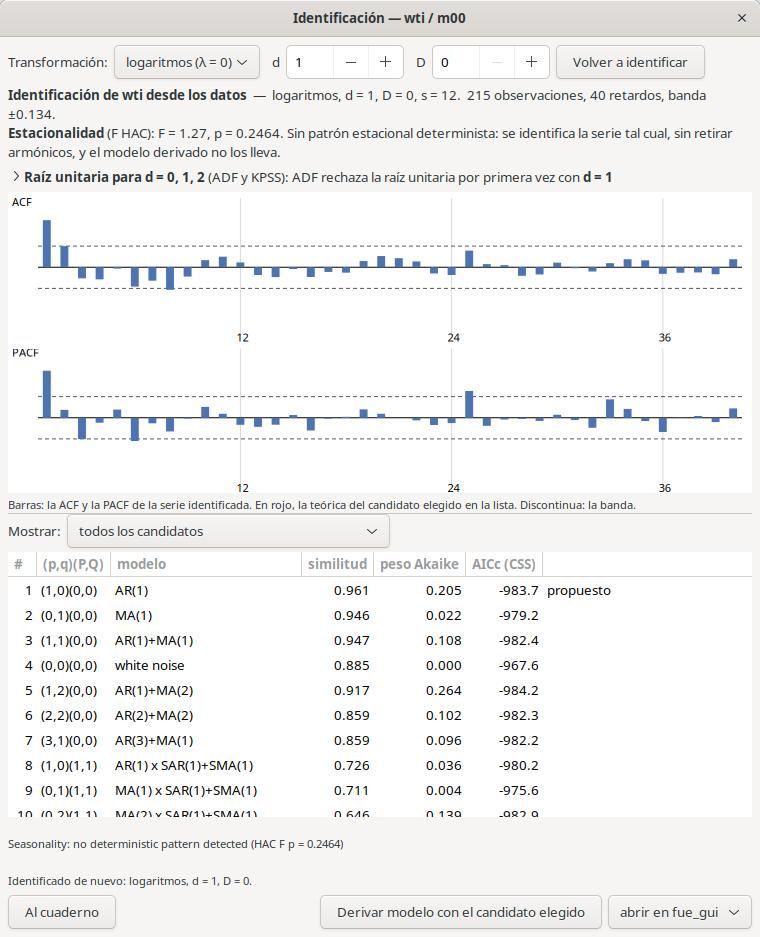

Elige **AR(1)**, deriva m01, estímalo y abre su diagnosis:

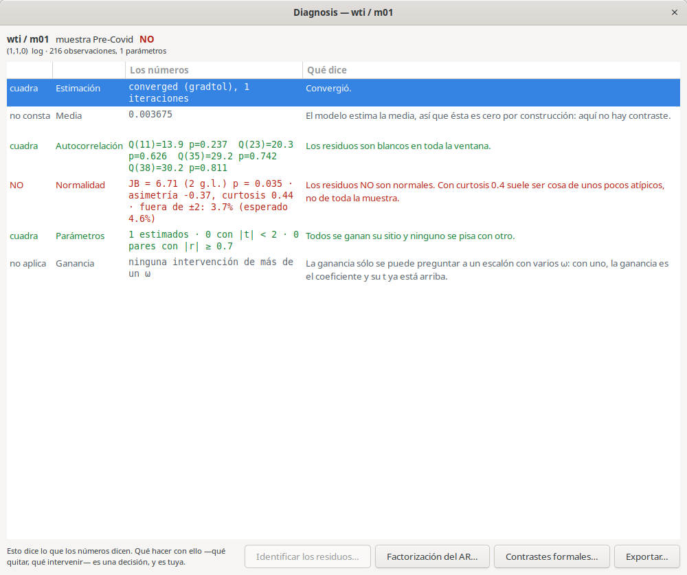

Todo cuadra **salvo la normalidad**: Jarque-Bera rechaza (p = 0.035). El propio
programa sugiere la causa: con curtosis 0.4, *suele ser cosa de unos pocos
atípicos, no de toda la muestra*.

La fila **Media**, aquí sí, contrasta: m01 no lleva μ (el petróleo no tiene
deriva), y la media de los residuos no se distingue de cero (t = 0.65).

### Los anómalos

Botón derecho sobre m01 → **Anómalos…**:

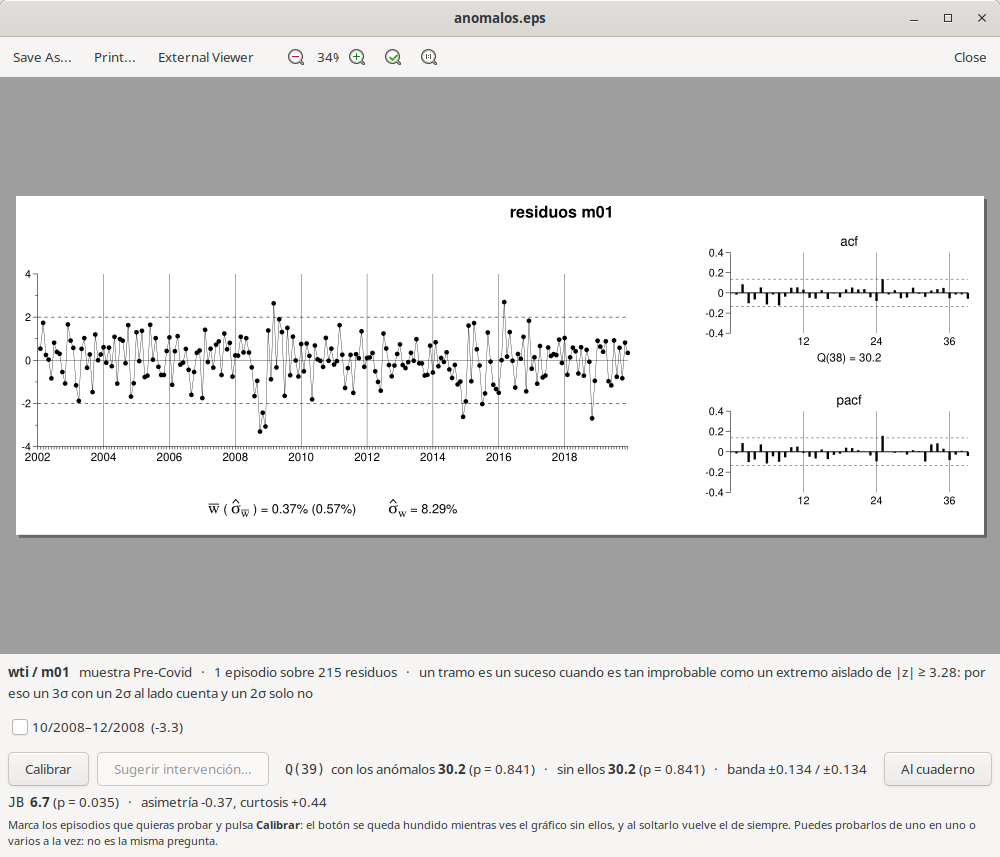

Los residuos, con un círculo en lo que se sale. Abajo, cada **episodio** con su
z: aquí uno, **10/2008–12/2008** (z = −3.3). Es el desplome del petróleo tras
la quiebra de Lehman Brothers.

> **Los anómalos se calibran, no se eliminan.** Y antes de intervenir hay que
> preguntarse si de verdad molestan.

**La pregunta que decide**: ¿cambia la identificación si se omite este
episodio? Si no cambia, intervenir es **sobreintervenir**. Marca la casilla del
episodio y pulsa **Calibrar**:

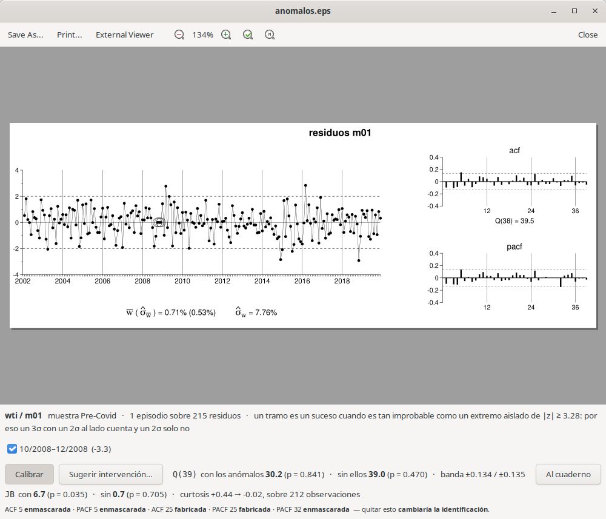

La línea de abajo responde: sin el episodio, varios retardos de la ACF y la
PACF cambian de lado de la banda (*enmascarada*, *fabricada*), y el programa
concluye: *quitar esto cambiaría la identificación*. Y la normalidad se
arregla: JB pasa de 6.7 (p = 0.035) a 0.7 (p = 0.705). **Hay que intervenir.**

### Qué forma tiene la intervención

Suelta **Calibrar** y pulsa **Sugerir intervención…**:

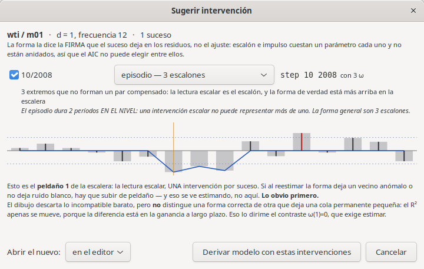

La **forma** la dice la firma que el suceso deja en los residuos, no el ajuste.
Aquí el episodio dura varios meses en el nivel, y una intervención escalar solo
puede representar uno: la forma propuesta son **3 escalones** desde 10/2008.

Reglas de la escuela para intervenir:

- **Una intervención cada vez**, y lo obvio primero.
- **No uses rampas**: un cambio en la tasa media de crecimiento es una cuestión
  del orden de integración, no de una intervención.
- Cada intervención reduce la desviación típica de los residuos, así que eso no
  sirve para saber cuándo parar. Se para cuando calibrar **deja de cambiar la
  identificación**.

Deja **en el editor** y pulsa **Derivar modelo con estas intervenciones**. Nace
**m02**: el mismo AR(1) más los tres escalones. Estímalo y abre su diagnosis:

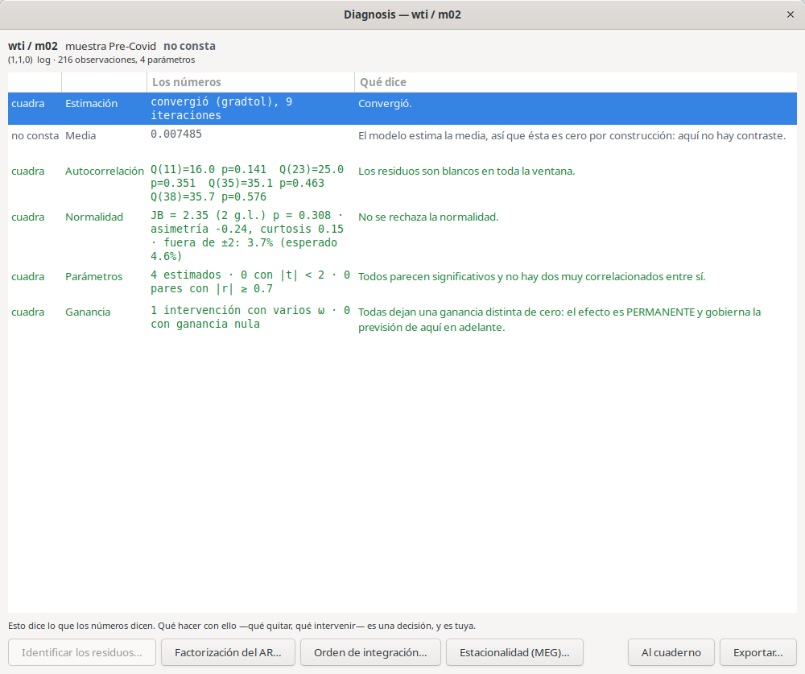

Ahora todo cuadra, también la normalidad y la media de los residuos
(t = 1.43), y los cuatro parámetros parecen significativos. La fila
**Ganancia** ya tiene qué preguntar: los tres escalones dejan una ganancia
distinta de cero, un efecto **permanente** en el nivel del petróleo. **Diagnosticar ▸ Ganancia…** da el contraste.

---

## 10. Declarar el modelo elegido

Cada serie tiene ya varios modelos. **Cuál es el bueno es una decisión, y hay
que declararla**: si no, no está en ninguna parte.

Marca m01 del IPC y pulsa **Elegir**. ATSW pide la razón:

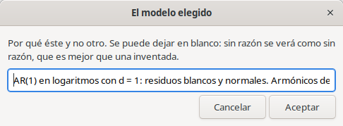

Escribe por qué este y no otro. Se puede dejar en blanco, pero *sin razón se
verá como sin razón, que es mejor que una inventada*. Haz lo mismo con m02 de
wti.

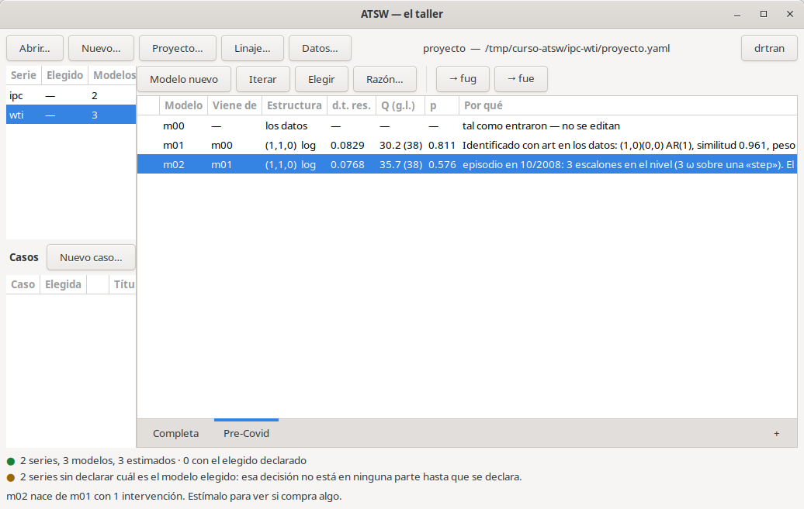

El pie de la ventana lleva la cuenta: cuántos modelos hay estimados y cuántas
series tienen ya su elegido declarado.

---

## 11. El caso: las dos series juntas

Un **caso** es un conjunto **fijo y ordenado** de series, cada una con el
`.pre` con el que entra. Es el punto de partida del escalón de transferencia.

En el panel **Casos — MT**, abajo a la izquierda, pulsa **Nuevo caso…** (o
*MT ▸ Nuevo caso…*):

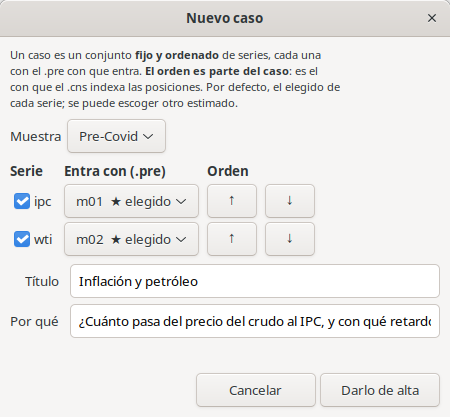

- **Muestra**: Pre-Covid. Todas las series tienen que venir de la misma.
- Marca **ipc** y **wti**. Por defecto entra el **elegido** de cada una.
- **El orden importa: la primera serie es la salida.** Aquí ipc, porque es lo
  que queremos explicar. Ningún dato puede decidir cuál es la salida: lo decides
  tú, y cargarlas al revés da en silencio un modelo de otra cosa.
- **Título** y **Por qué**: la pregunta del caso.

Pulsa **Darlo de alta** y marca **C1**:

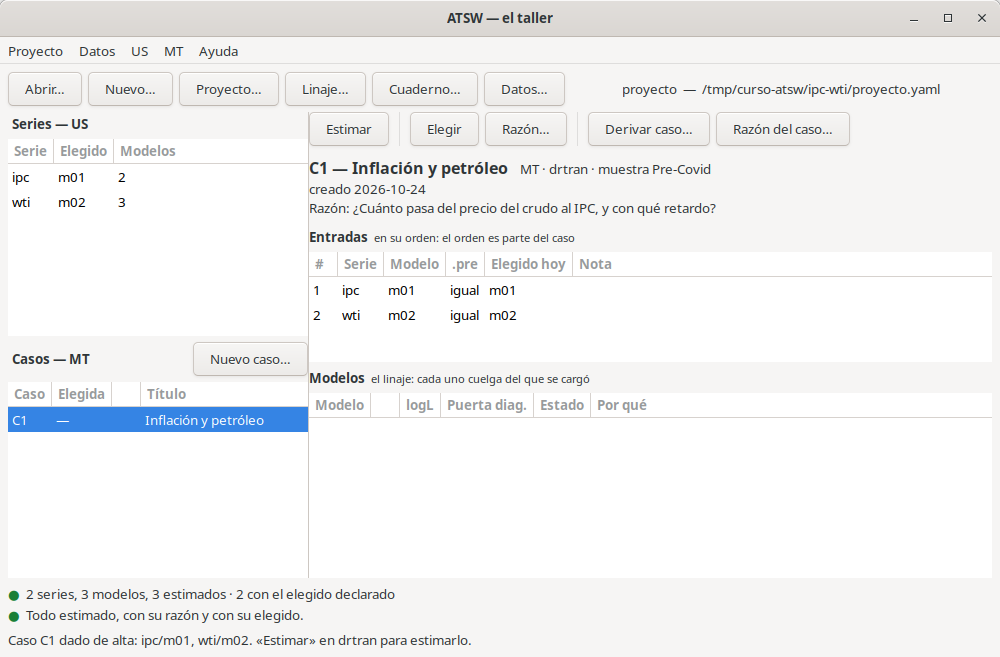

La tabla de **Entradas** dice con qué modelo entra cada serie y si su `.pre`
sigue siendo el mismo con que se dio de alta (*igual*). Si mañana cambias el
modelo elegido de una serie, el caso no cambia: sigue con el que tenía. Para
usar el nuevo, **Derivar caso…**.

**¿Por qué se parte de los `.pre` y no de los datos?** Porque el modelo
univariante de cada serie ya está resuelto, y la transferencia **no vuelve a
identificarlo**: el modelo de la entrada queda como está, y el de la salida es
la semilla del modelo del ruido.

Pulsa **Estimar**, en la fila de botones del caso (o Ctrl+E): se abre drtran
con el caso cargado. El menú **MT** y el botón derecho sobre el caso tienen lo
demás: derivar el caso, su razón y borrarlo.

---

## 12. La función de transferencia en drtran

drtran trabaja en siete pestañas, de izquierda a derecha. Arriba tiene una
barra como la de fue_gui: **Estimar** (Ctrl+E, desde cualquier pestaña),
**Ver modelo**, **Diagnosis** y **Prever**. Un clic en el botón hace lo
habitual; la flecha de al lado abre el resto.

### 1 · Series

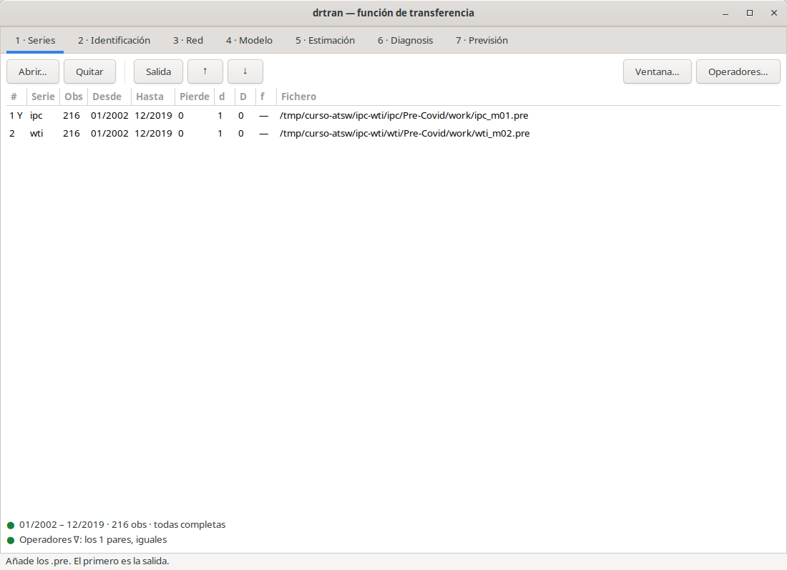

El caso llega cargado: ipc es la salida (la primera) y wti la entrada. drtran
comprueba que las dos tienen la misma frecuencia, la misma última fecha y el
mismo número de observaciones.

### 2 · Identificación: el preblanqueo y la CCF

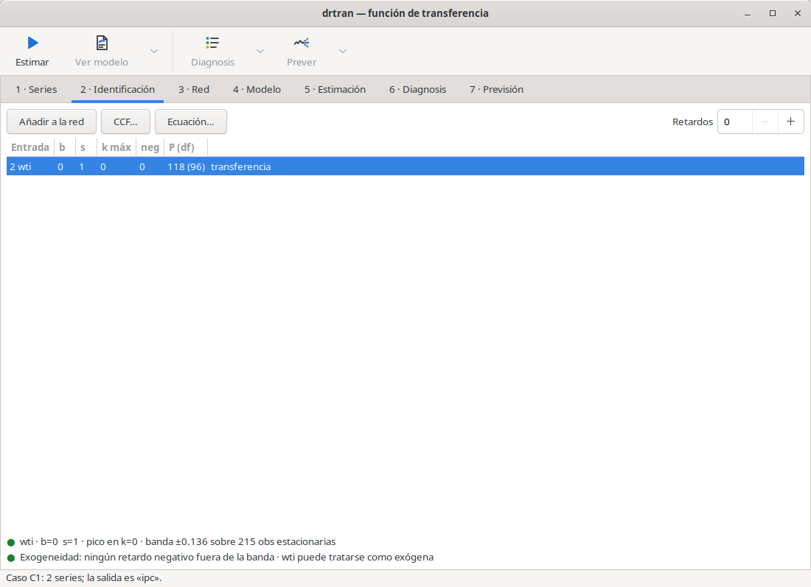

Para ver cómo responde el IPC al petróleo hay que mirar la **correlación
cruzada** (CCF) entre las dos. Pero calculada sobre las series tal cual, la CCF
engaña: la propia dinámica de cada serie la contamina. Por eso se **preblanquea**:

1. Se filtra la entrada (wti) con su propio modelo ARMA hasta dejarla en ruido
   blanco.
2. **Se aplica el mismo filtro a la salida** (ipc). Es el paso que suele
   olvidarse.
3. Se calcula la CCF entre las dos series filtradas.

Pulsa **CCF…**:

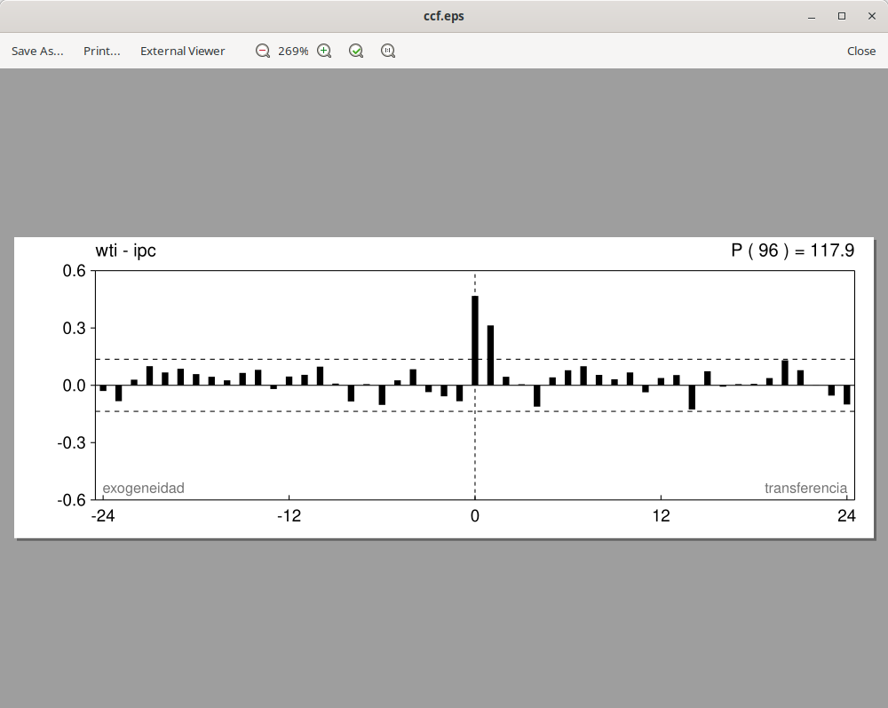

- **A la derecha (k ≥ 0, «transferencia»)**: el IPC responde al petróleo con k
  meses de retardo. Hay dos barras claras: **k = 0 y k = 1**.
- **A la izquierda (k < 0, «exogeneidad»)**: el IPC adelantándose al petróleo.
  No debería haber nada, y no lo hay: el petróleo es **exógeno**.

La forma de la respuesta se escribe con tres números, **b r s**:

| | Qué es |
|---|---|
| **b** | El **retardo puro**: cuántos meses tarda en empezar la respuesta. |
| **s** | El orden del **numerador** ω(B): s + 1 coeficientes libres. |
| **r** | El orden del **denominador** δ(B): una respuesta que se va apagando. |

drtran lee la CCF así: **b** es el primer retardo significativo (aquí 0) y se
toma el **bloque contiguo** de barras significativas desde ahí (k = 0 y 1). Con
todos los pesos libres, eso es **b = 0, r = 0, s = 1** (dos coeficientes). Es lo
que propone la tabla.

Pero hay otra lectura. Las dos barras son 0.46 y 0.31: **la segunda es una
fracción de la primera**, como en una respuesta que se apaga geométricamente.
Eso es **b = 0, r = 1, s = 0**: un coeficiente y un denominador. También tiene
dos parámetros, y dice algo distinto: que el efecto se va repartiendo en el
tiempo.

> **La CCF no puede enseñar r.** Una respuesta que decae y unos pocos pesos
> libres dejan casi la misma CCF. Las dos lecturas se **estiman** y se
> comparan.

En este manual seguimos con **r = 1**, que es la lectura económica habitual del
*pass-through*: el efecto del petróleo llega sobre todo el mismo mes y se va
acumulando después. Al final te proponemos estimar también la otra.

Pulsa **Añadir a la red**.

### 3 · Red

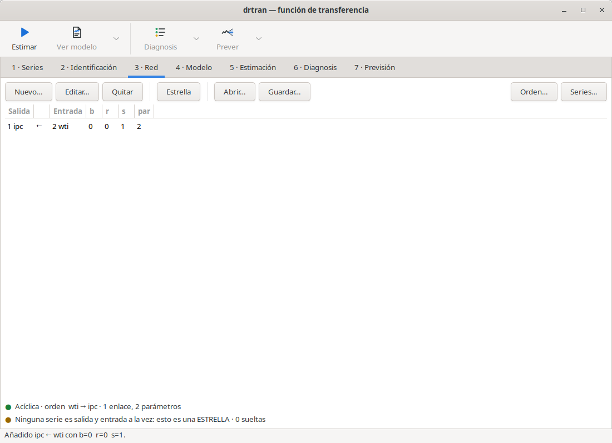

La red tiene un enlace, **ipc ← wti**, con lo que propuso la identificación
(b = 0, r = 0, s = 1). Márcalo y pulsa **Editar…**:

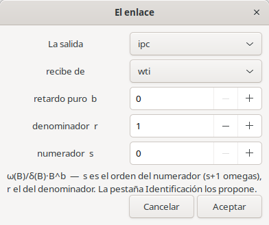

Pon **denominador r = 1** y **numerador s = 0**, y acepta:

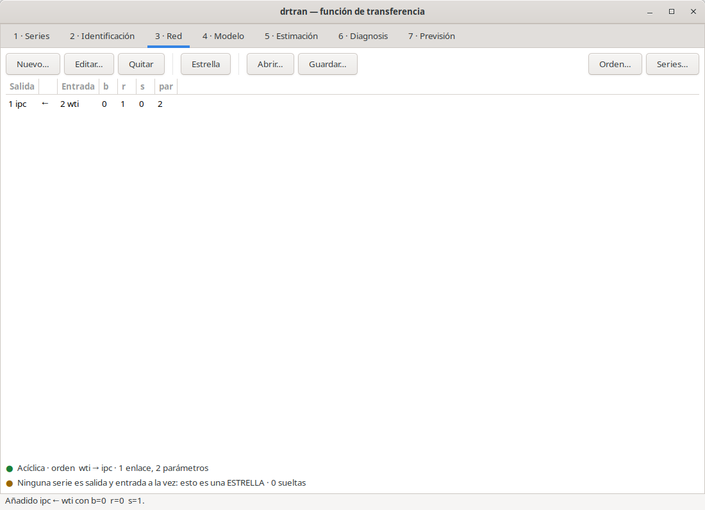

Abajo, drtran comprueba que la red es **acíclica**: ninguna serie es a la vez
salida y entrada de otra que la afecta. Un ciclo sería un sistema simultáneo, y
eso es un modelo VARMA, no una transferencia.

### 4 · Modelo

Aquí se pueden fijar o compartir parámetros (un fichero `.cns`). Para este caso
no hace falta tocar nada.

### 5 · Estimación

Pulsa **Estimar**:

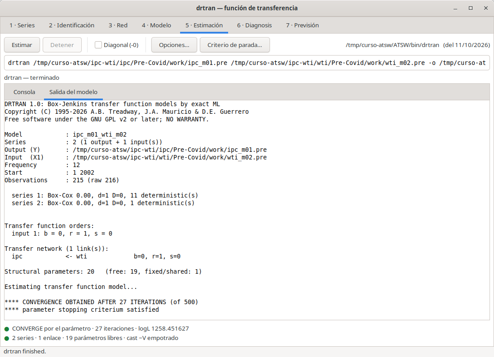

drtran estima **todo a la vez** por máxima verosimilitud exacta: la
transferencia, el modelo del ruido del IPC y el modelo del petróleo. Lo primero
es comprobar que **converge**. La línea de abajo da la verosimilitud (logL).

### 6 · Diagnosis

La diagnosis tiene sus propias pestañas, y el orden importa: **primero la
relación, después el ruido**. Una relación mal especificada ensucia la CCF y la
ACF de los residuos; un ruido mal especificado solo ensucia la ACF.

**1 · Exogeneidad**: la Q de la CCF entre los residuos del IPC y el petróleo
preblanqueado, en los retardos **negativos**.

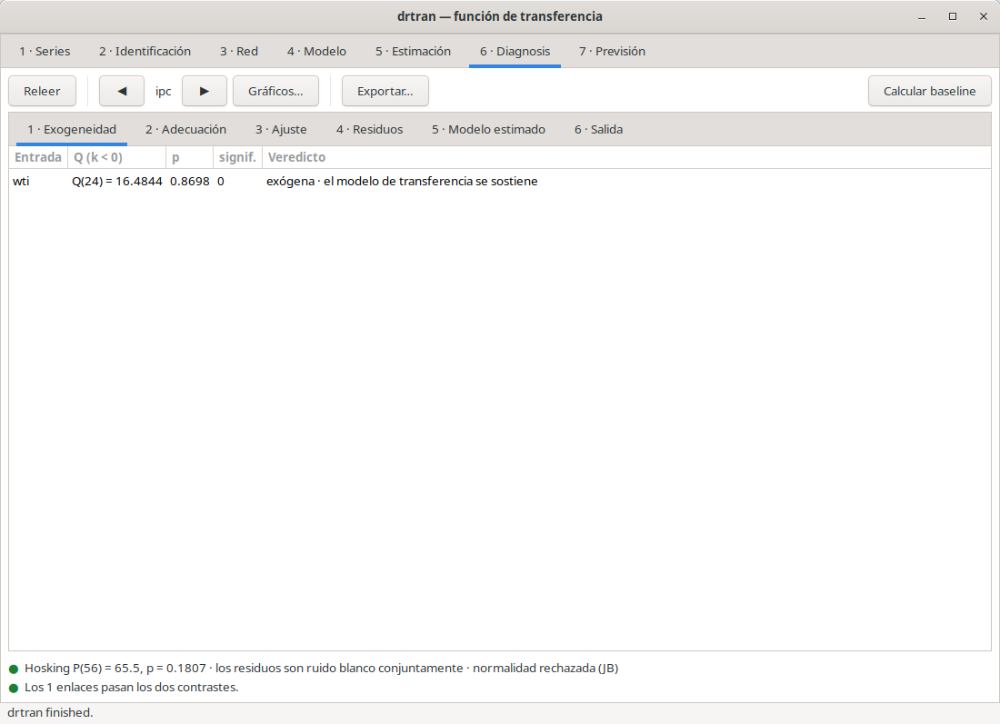

Si fallara, el sistema sería simultáneo y habría que ir a VARMA. Aquí
p = 0.81: **wti es exógena**.

**2 · Adecuación**: la misma Q en los retardos **k ≥ 0**. Si falla, la *forma*
(b, r, s) está mal.

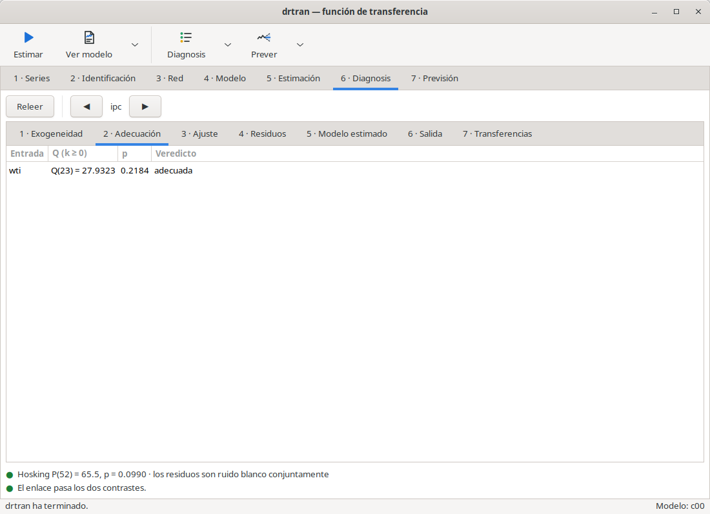

p = 0.18: **la forma es adecuada**. Abajo, el contraste de Hosking dice que los
residuos de las dos ecuaciones son ruido blanco conjuntamente (p = 0.19). La
misma línea avisa de que el Jarque-Bera multivariante rechaza la normalidad
(p = 0.022): los residuos del IPC tienen algo de curtosis (1.1). No invalida
la estimación, pero las bandas de la previsión, que suponen normalidad, hay que
leerlas con esa reserva.

**3 · Ajuste**: ¿merece la pena la transferencia? Converger y merecer la pena
son afirmaciones distintas. Hay que compararla con el **modelo diagonal**, las
dos series sin relación entre ellas. Se calcula desde la flecha de
**Diagnosis**, en la barra:

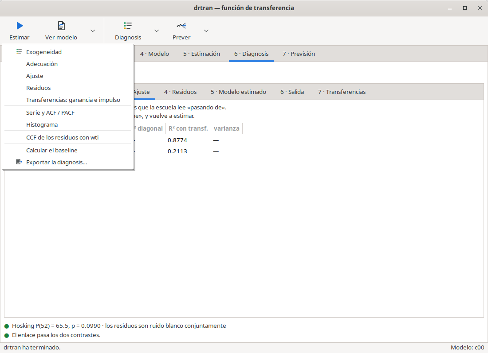

1. Elige **Calcular el baseline**: drtran estima el modelo diagonal.
2. Vuelve a **5 · Estimación** y pulsa **Estimar**.
3. Vuelve a **3 · Ajuste**:

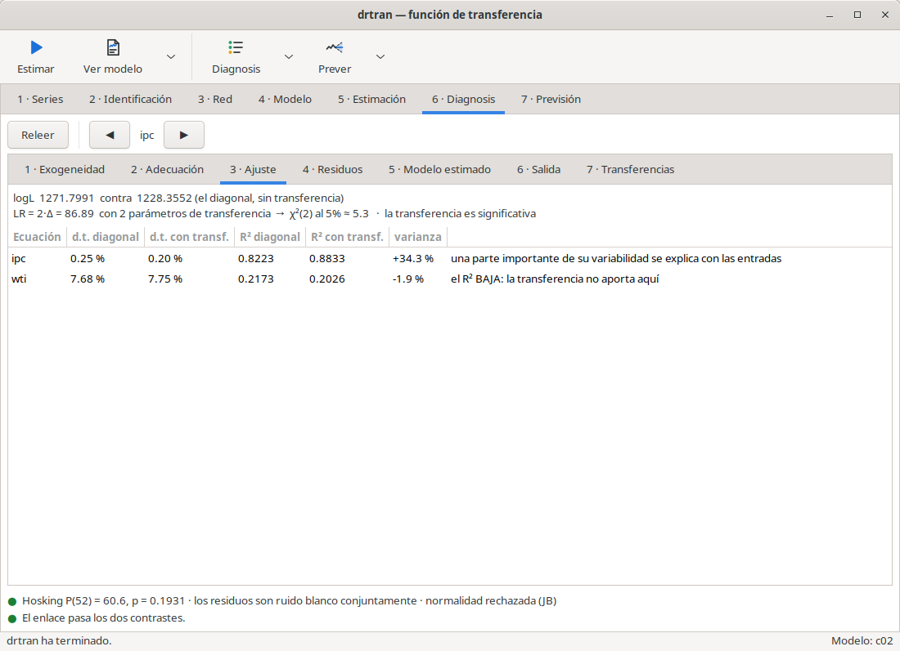

- **LR = 86.89** con 2 parámetros de transferencia, frente a un valor crítico de
  5.3 al 5 %: **la transferencia es significativa**.
- La varianza de los residuos del IPC baja un **34.3 %**: una parte importante
  de su variabilidad se explica con el petróleo.
- En wti apenas cambia (−1.9 %), como debe ser: wti es la entrada, no
  responde a nadie.

**4 · Residuos**: la ACF de los residuos de cada ecuación, con la Q de
Ljung-Box. El mismo menú de **Diagnosis** tiene los gráficos: la serie de
residuos con su ACF y PACF, el histograma y la CCF de los residuos con cada
entrada:

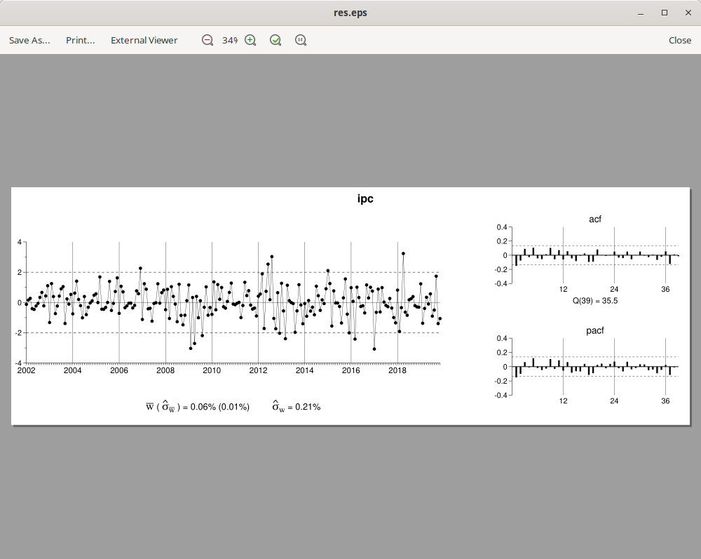

**5 · Modelo estimado**: la tabla de parámetros, con los nombres del modelo y
en las unidades de la ecuación. Las flechas ◀ ▶ de arriba pasan de una
ecuación a otra (ipc, wti).

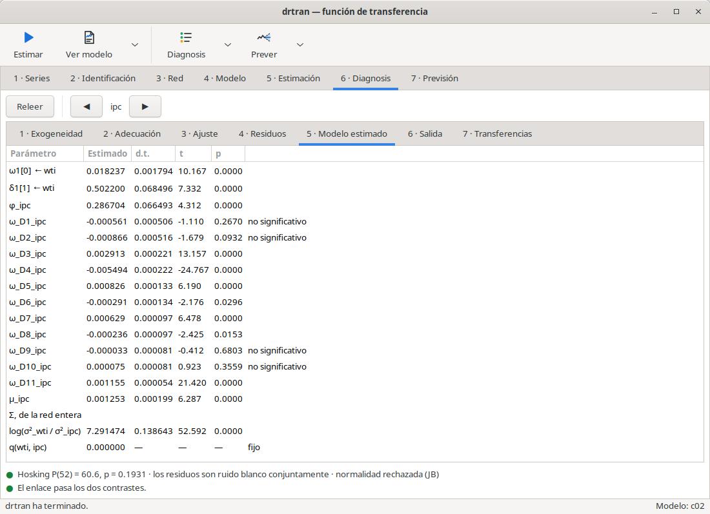

| Parámetro | Qué es | Valor |
|---|---|---|
| `ω1[0] ← wti` | ω₀, el efecto del mismo mes | 0.018 (d.t. 0.002) |
| `δ1[1] ← wti` | δ₁, cuánto se arrastra cada mes | 0.502 (d.t. 0.068) |
| `φ_ipc` | el AR(1) del ruido del IPC | 0.287 |
| `ω_D1_ipc`… | los armónicos del IPC | |
| `μ_ipc` | la deriva del IPC: su crecimiento medio mensual que no viene del petróleo | 0.0013 (d.t. 0.0002) |
| `φ_wti` | el AR(1) del petróleo (en la ecuación de wti) | 0.223 |
| `ω_D1_wti`… | los tres escalones de 2008 del petróleo (ídem) | |

**7 · Transferencias**: la **ganancia** y el **retardo medio** de cada enlace,
con su desviación típica, y la **respuesta al impulso**: cuánto responde el
IPC k meses después de un impulso en el petróleo, y la respuesta acumulada a
un cambio permanente, que tiende a la ganancia.

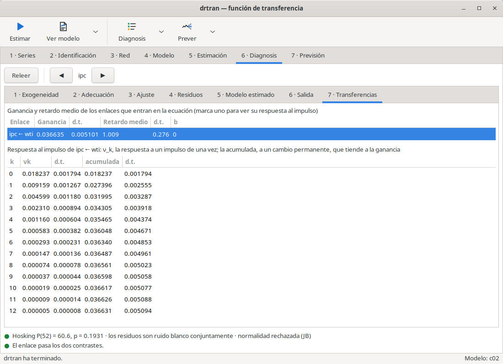

**Ver modelo**, en la barra, enseña la página de la ecuación, igual que la de
un modelo univariante con la transferencia delante de los deterministas: los
residuos con su ACF y PACF, el modelo estimado y los residuos grandes.

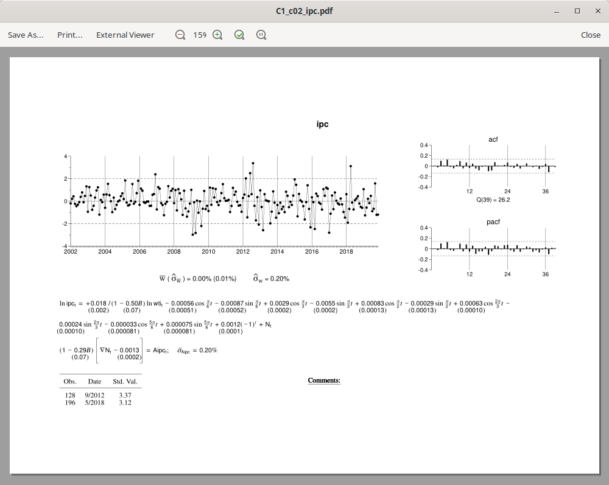

### Leer el resultado

El modelo, en dos ecuaciones:

```
ln IPC_t = ω₀ / (1 − δ₁ B) · ln WTI_t  +  D_t  +  N_t
(1 − φ B) (∇ N_t − μ) = a_t
```

La primera es la **transferencia en niveles**, con los deterministas (D_t, los
armónicos) y el **ruido** N_t. La segunda es el modelo del ruido: un AR(1) en
diferencias, alrededor de la deriva μ = 0.0013 (un 0.13 % al mes, cerca de un
1.5 % al año, de inflación que no viene del petróleo).

Como las dos series están en logaritmos, los coeficientes son **elasticidades**:

- **Efecto del mismo mes**: ω₀ = 0.018. Si el petróleo sube un 10 %, el IPC
  sube un 0.18 % ese mismo mes.
- **Ganancia** (el efecto a largo plazo, cuando la subida del petróleo es
  permanente): ω₀ / (1 − δ₁) = 0.018 / (1 − 0.502) ≈ **0.037** (d.t. 0.005,
  en **7 · Transferencias**). Una subida permanente del 10 % en el petróleo
  acaba subiendo el IPC un **0.37 %**.
- **Retardo medio**: δ₁ / (1 − δ₁) ≈ **1 mes** (1.01, d.t. 0.28). La mayor
  parte del efecto llega en el primer trimestre.

> Una advertencia de la escuela: si δ₁ se acercara a 1 (más de 0.95), la
> ganancia y el retardo medio no serían fiables. Aquí δ₁ = 0.50, lejos de eso.

---

## 13. La previsión

Pestaña **7 · Previsión** (o el botón **Prever** de la barra). Marca
**Prever**, deja 8 periodos y pulsa **Calcular**:

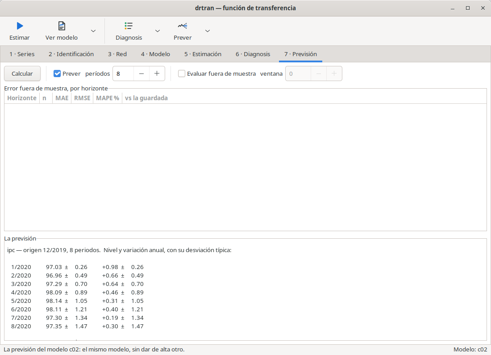

Desde 12/2019, el nivel del IPC y su variación anual, cada uno con su
desviación típica. El IPC de enero de 2020 fue 97.14; el modelo prevé
97.14 ± 0.25.

Dos cosas que hay que tener claras:

- **Prever la salida exige prever las entradas**. El error de la previsión del
  IPC suma su propia innovación y la del petróleo, propagada por la
  transferencia.
- **Las bandas son teóricas**: suponen que el modelo es el verdadero. Lo único
  empírico es **Evaluar fuera de muestra**: estima una vez, fija los
  parámetros y va moviendo el origen, comparando cada previsión con lo que de
  verdad pasó. Es lo que decide entre dos modelos.

Y como el modelo está en logaritmos, las bandas del nivel son **asimétricas**:
nunca calcules «nivel ± 1.96 × d.t.» a mano.

---

## 14. Lo que queda por hacer

Un modelo **adecuado** dice que los datos no lo contradicen, no que no haya uno
mejor. Antes de darlo por bueno:

1. **Estima la otra lectura** de la CCF: b = 0, **r = 0, s = 1**. Compara la
   verosimilitud de las dos. Tienen el mismo número de parámetros, así que gana
   la de mayor logL; si la diferencia es pequeña, mira qué dice cada una de la
   ganancia.
2. **Sobreajusta**: prueba s + 1 y r + 1, uno cada vez, y contrasta con la razón
   de verosimilitudes (1 grado de libertad). Un sobreajuste con correlaciones
   altas entre parámetros es un experimento **fallido**, no una mejora.
3. **Si falla la adecuación, calibra antes de re-especificar**: puede ser la
   forma o puede ser una observación. Si es una observación, es una
   intervención, y se trata en el modelo univariante.
4. **Reformula el ruido** si su ACF lo pide, *después* de la relación.
5. En el taller, la tabla de **Modelos** del caso guarda cada estimación con su
   logL y su razón. **Elige** el modelo del caso y escribe por qué, como hiciste
   con las series. El botón derecho sobre un modelo del caso tiene **Ver
   modelo…**: la misma página que da **Ver modelo** en drtran, con los
   residuos y las ecuaciones estimadas, sin abrir drtran. Si la red tiene más
   ecuaciones, cada una tiene su página debajo. Y abrir en drtran un modelo ya
   estimado enseña su informe y su diagnosis sin volver a estimarlo.

Y si la identificación de una red con más series encontrara un **ciclo**
(dos series que se afectan mutuamente), ahí termina la transferencia: el
siguiente escalón es **drvarma** (modelos VARMA), con los mismos `.pre`.
Todavía no viene en el paquete.

---

## 15. Las reglas de oro

1. **Mira antes de contrastar.** El gráfico y el correlograma deciden; los
   contrastes ayudan.
2. **El dominio va primero**: un índice de precios va en logaritmos, siempre.
3. **d de uno en uno.** Diferenciar de más mete una raíz que luego estorba.
4. **La estacionalidad, determinista como hipótesis de trabajo.** El MEG va
   antes de podar armónicos.
5. **Los empates se resuelven estimando**, no eligiendo.
6. **La propuesta del programa es evidencia, no un veredicto.**
7. **Los anómalos se calibran, no se eliminan.** Una intervención cada vez. Sin
   rampas.
8. **No añadas un parámetro no significativo para que cuadre un criterio.**
9. **Cada modelo, con su razón.** Lo valioso de una iteración fallida no es el
   modelo que se tira: es el motivo.
10. **Un `.pre` no se escribe a mano, y uno tocado vuelve a ser un `.inp`.**
11. **En la transferencia, la primera serie es la salida**, y se parte de los
    `.pre`, no de los datos.
12. **Primero la relación, después el ruido.** Calibra antes de re-especificar.
13. **La CCF no enseña r**: las dos lecturas se estiman.
14. **Converger no es merecer la pena**: compara con el diagonal.

---

## 16. Glosario

| Término | Qué quiere decir |
|---|---|
| **ACF / PACF** (FAS / FAP) | Funciones de autocorrelación simple y parcial. La banda ±2/√n separa lo significativo. |
| **Anómalo** | Una observación cuyo residuo es improbable. Se calibra, no se elimina. |
| **Armónicos** | Ondas de seno y coseno que representan una estacionalidad determinista. |
| **Caso** | Un conjunto fijo y ordenado de series, cada una con su `.pre`. La primera es la salida. |
| **Cuaderno** | El diario del proyecto, en Markdown: lo que se lleva con «Al cuaderno» y tus notas. Solo crece. |
| **CCF** | Función de correlación cruzada entre dos series. |
| **Diagnosis** | La comprobación de que los residuos de un modelo son ruido blanco, normales y centrados. |
| **Diagonal** | El modelo de varias series sin relación entre ellas. La vara de medir de la transferencia. |
| **Dominio** | Qué clase de serie es y qué espera la teoría de ella. Se declara antes de estimar. |
| **Elegido** | El modelo que declaras como el bueno de una serie, con su razón. |
| **Exógena** | Una entrada a la que la salida no afecta. Se contrasta en los retardos negativos de la CCF. |
| **Ganancia** | El efecto a largo plazo de un cambio permanente en la entrada: ω(1)/δ(1). |
| **Intervención** | Un término determinista (impulso, escalón) que representa un suceso conocido. |
| **Ljung-Box (Q)** | Contraste conjunto de que las autocorrelaciones de los residuos son cero. |
| **Muestra** | Una ventana declarada sobre los datos. Cada una es una hoja con sus modelos. |
| **Preblanqueo** | Filtrar la entrada con su modelo hasta dejarla en ruido blanco, y la salida con el mismo filtro. |
| **Red** | Los enlaces salida ← entrada de un modelo de transferencia, con sus b r s. |
| **Ruido (N_t)** | Lo que la transferencia no explica de la salida. Tiene su propio modelo ARIMA. |
| **Salida / entrada** | La serie que se explica y las que la explican. |
| **Sobreintervenir** | Intervenir un anómalo que no cambia la identificación. |

---

*Las capturas de este manual se generan con el programa:
`bash docs/manual/capturas/capturas.sh` rehace el caso desde los datos y vuelve
a fotografiar cada pantalla. Si un botón cambia de nombre, el guion falla
diciendo cuál.*
